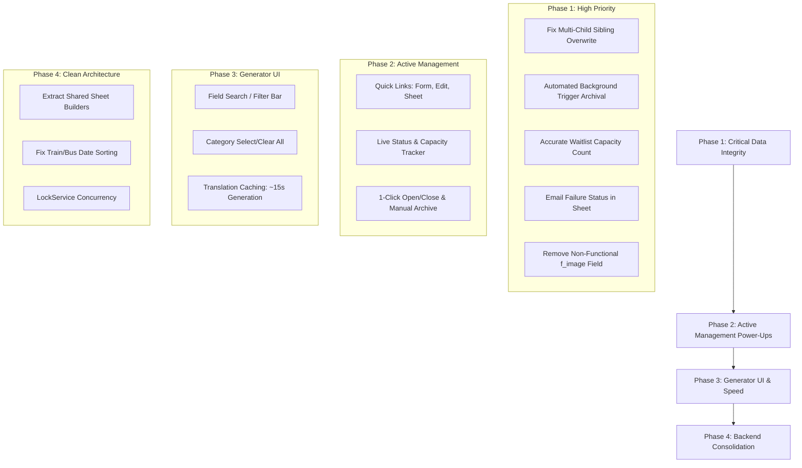

# USGA Event Registration Form Generator - Comprehensive Review & Recommendations

**Date:** September 28, 2026  
**Auditor:** Antigravity AI Assistant  
**Files Reviewed:**
- [`Code.gs`](file:///Users/mbpliou5/Documents/USGA%20Projects/Code.gs) (Current production backend script)
- [`Code_v2.8.gs`](file:///Users/mbpliou5/Documents/USGA%20Projects/Code_v2.8.gs) (Version 2.8 snapshot, byte-for-byte identical to `Code.gs`)
- [`Sidebar.html`](file:///Users/mbpliou5/Documents/USGA%20Projects/Sidebar.html) (Event Form Generator UI: sidebar & wide dialog)
- [`ManageEventsSidebar.html`](file:///Users/mbpliou5/Documents/USGA%20Projects/ManageEventsSidebar.html) (Active event lifecycle management UI)

---

## Executive Summary & Priority Matrix

| Category | Priority | Area | Key Finding / Recommendation | Expected Impact |
| :--- | :--- | :--- | :--- | :--- |
| **1. Critical Integrity** | 🔴 **High** | `Code.gs` | **Multi-Child Registration Overwrite Bug:** `Pickup`, `Drop-Off`, and `Logistics` match solely on `emailRecipient`. When parents register multiple children under one parent email, Child B overwrites Child A's rows. | Prevents silent data loss and missing transportation for siblings in youth events. |
| **1. Critical Integrity** | 🔴 **High** | `Code.gs` | **Automated Trigger Archiving (20-Trigger Limit):** When active forms reach 18, `generateForm()` deletes older triggers blindly. Automated archiving via the hourly cron can retire triggers when events end with zero coordinator effort. | Prevents older, still-active events from losing email receipts and logistics synchronization. |
| **1. Critical Integrity** | 🟡 **Medium** | `Sidebar.html` / `Code.gs` | **Unused Header Image Input (`f_image`):** Google Forms API has a platform limitation that prevents programmatic setting of decorative Theme Header Banners. `f_image` is currently ignored and should be removed from the UI. | Eliminates coordinator confusion and removes non-functional UI elements. |
| **1. Critical Integrity** | 🟡 **Medium** | `Code.gs` | **Waitlist Calculation Flaw:** Capping checks `(currentRow - 1) > maxAttendees`, which includes rejected medical releases and blank rows toward the capacity limit. | Ensures waitlists trigger strictly on confirmed, eligible attendees. |
| **1. Critical Integrity** | 🟡 **Medium** | `Code.gs` | **Missing Error Notification in Sheet:** If `GmailApp` and `MailApp` fail (e.g. quota limits), `Email Status` is left completely blank. | Gives coordinators immediate visibility into failed email receipts. |
| **2. Active Management** | 🔴 **High** | `ManageEventsSidebar.html` | **Missing Quick Links:** Coordinators cannot open the live form, form editor, or response sheet from the sidebar. | Eliminates needing to manually hunt through Google Drive folders. |
| **2. Active Management** | 🔴 **High** | `ManageEventsSidebar.html` | **Real-Time Status & Capacity Tracker:** No indicator shows whether the event is Open, Closed, or Scheduled, or current registrant count vs capacity. | Gives instant operational visibility without opening the spreadsheet. |
| **2. Active Management** | 🟡 **Medium** | `ManageEventsSidebar.html` | **1-Click Manual Toggle & Safe Event Archival:** No way to immediately open/close a form or safely retire a finished event's trigger (with zero data loss). | Provides instant lifecycle control and frees up project trigger slots. |
| **3. Generator UI** | 🟡 **Medium** | `Sidebar.html` | **Field Search / Filter:** Scrolling through 50+ fields in a 350px sidebar is cumbersome. | Accelerates finding optional fields (*Interpretation*, *T-Shirt Size*, etc.). |
| **3. Generator UI** | 🟡 **Medium** | `Sidebar.html` | **Category "Select All / Deselect All":** No batch-toggle for categories. | Speeds up custom event creation by dozens of clicks. |
| **3. Generator UI** | 🟢 **Low** | `Sidebar.html` | **Progress Indicator:** Static text during 45–60s creation creates user anxiety that the script froze. | Enhances perceived performance and UX confidence. |
| **4. Architecture** | 🟡 **Medium** | `Code.gs` | **Code Duplication (300+ Lines):** `generateForm` and `upgradeExistingSheet` have identical copy-pasted sheet construction logic. | Eliminates schema drift and maintenance overhead. |
| **4. Performance** | 🟡 **Medium** | `Code.gs` | **Translation Caching:** Translating 35+ fields and choices individually triggers 100+ API calls, causing 45–60s lag and burning quota. | Drops generation time down to 10–15 seconds. |
| **4. Architecture** | 🟢 **Low** | `Code.gs` | **Transportation Sort Order:** Sorting by Airport code first causes Train/Bus travelers (blank airport) to group at the top out of date order. | Sorts pickups by Date and Time first, then Location. |

---

## 1. Critical Reliability & Data Integrity Findings

### 1.1 Multi-Child Registrations Overwriting Pickup, Drop-Off & Logistics
* **Location:** [`Code.gs: lines 1640-1644`](file:///Users/mbpliou5/Documents/USGA%20Projects/Code.gs#L1640-L1644), [`lines 1727-1731`](file:///Users/mbpliou5/Documents/USGA%20Projects/Code.gs#L1727-L1731), [`lines 1830-1836`](file:///Users/mbpliou5/Documents/USGA%20Projects/Code.gs#L1830-L1836)
* **Problem:** In `masterRespondToRegistration`, existing records on `Pickup`, `Drop-Off`, and `Logistics` are found by matching only `emailRecipient`:
  ```javascript
  if (data[i][2] && String(data[i][2]).toLowerCase() === emailRecipient.toLowerCase()) {
    foundRowIndex = i + 1;
    break;
  }
  ```
* **Real-World Hazard:** In church youth events (SSC, SMC, MMP, CYSC), parents frequently submit separate registrations for two or more siblings using the parent's email. When the second sibling's form arrives, the script matches the parent's email on the first sibling's row and **completely overwrites the first child's flight, room, and logistics data**.
* **Remediation:**
  Match on a composite key: `(Email + First Name + Last Name)`.
  ```javascript
  const rowKey = `${String(data[i][0]).trim().toLowerCase()}_${String(data[i][1]).trim().toLowerCase()}_${String(data[i][2]).trim().toLowerCase()}`;
  const targetKey = `${firstName.trim().toLowerCase()}_${lastName.trim().toLowerCase()}_${emailRecipient.trim().toLowerCase()}`;
  if (rowKey === targetKey) {
    foundRowIndex = i + 1;
    break;
  }
  ```

---

### 1.2 Quota Hardening: Blind Deletion of Triggers vs. Fully Automated Archiving
* **Location:** [`Code.gs: lines 1002-1010`](file:///Users/mbpliou5/Documents/USGA%20Projects/Code.gs#L1002-L1010)
* **The Current Hazard:** Google Apps Script enforces a strict quota of **20 installable triggers per user per project**. `generateForm()` currently handles this with a crude auto-archiver:
  ```javascript
  const triggers = ScriptApp.getProjectTriggers();
  if (triggers.length >= 19) {
    const formTriggers = triggers.filter(t => t.getHandlerFunction() === 'masterRespondToRegistration');
    const excess = triggers.length - 18;
    for (let i = 0; i < excess && i < formTriggers.length; i++) {
      ScriptApp.deleteTrigger(formTriggers[i]);
    }
  }
  ```
  This arbitrarily deletes the earliest triggers created. If older events are still active (e.g., registration closes in two weeks), their automated email confirmations and logistics sync will silently terminate without warning.

* **Automating Past Event Archiving (Zero Manual Effort):**
  This cleanup can be **100% automated** using the existing hourly background cron [`masterFormLifecycleCron()`](file:///Users/mbpliou5/Documents/USGA%20Projects/Code.gs#L2826-L2884).
  - The cron already runs every hour. When it detects that `now > (config.end + bufferWindow)` (e.g., 2–3 days after the event concludes):
    1. It retrieves the form's destination spreadsheet ID: `const destId = form.getDestinationId();`.
    2. It inspects all project triggers and finds the `masterRespondToRegistration` trigger where `trigger.getTriggerSourceId() === destId`.
    3. It safely deletes that specific trigger via `ScriptApp.deleteTrigger(trigger)`.
    4. It ensures the form is closed (`form.setAcceptingResponses(false)`).
    5. It removes the form ID from `FormsToMonitor`.
  - **Outcome:** Past events are automatically decommissioned in the background as soon as they conclude, keeping active project triggers well under the 20-trigger quota without requiring any coordinator action.

---

### 1.3 Clarification on Header Image Input (`f_image`) & Google Forms API Limitation
* **Location:** [`Sidebar.html: lines 204-206`](file:///Users/mbpliou5/Documents/USGA%20Projects/Sidebar.html#L204-L206)
* **Problem & Platform Limitation:**
  In `Sidebar.html`, there is an input field:
  ```html
  <label for="f_image">Header Image (Google Drive ID)</label>
  <input type="text" id="f_image" value="1KltAMA0tXmJeeam2pg_omUjMvD5_un-d" placeholder="Leave blank for no image">
  ```
  **Why programmatic header banners cannot be automated:**
  - Neither Google Apps Script (`FormApp`) nor the modern Google Forms REST API (v1) exposes any property or endpoint to programmatically set the decorative **Theme Header Banner image** at the top of a form.
  - While `form.addImageItem()` exists in Apps Script, it does **not** create a header banner; it inserts an inline question/body image block inside the form questions, which looks awkward and disjointed.
  - In `Code.gs`, `payload.eventDetails.imageId` is currently completely ignored during form generation, and `masterRespondToRegistration` hardcodes `"1KltAMA0tXmJeeam2pg_omUjMvD5_un-d"` for the outgoing email logo.
* **Recommendation:**
  Because the Google Forms platform does not permit setting theme header banners via code, **the `f_image` field should be removed entirely from `Sidebar.html`** to avoid confusing coordinators with non-functional options. If custom email logos are desired, the field should be re-labeled explicitly as *"Confirmation Email Logo Drive ID"*.

---

### 1.4 Waitlist Calculation Flaw
* **Location:** [`Code.gs: lines 1904-1907`](file:///Users/mbpliou5/Documents/USGA%20Projects/Code.gs#L1904-L1907)
* **Problem:** The waitlist check tests row index:
  ```javascript
  const currentRow = e.range.getRow();
  if ((currentRow - 1) > maxAttendees) {
     isWaitlisted = true;
  }
  ```
  - `currentRow - 1` naively counts all rows in `Form Responses 1`. If 10 registrants declined the Medical Consent and were rejected, they occupy 10 rows. As a result, valid registrant #41 could sit on row 51 and falsely receive a waitlist email even though only 40 valid participants have been accepted.
* **Remediation:**
  Count valid, non-rejected attendees prior to the current row, or pull the count from the `Participants` sheet formula (`COUNTIF(A2:A, "<>No responses yet")`).

---

### 1.5 Missing Failure Status in Response Sheet
* **Location:** [`Code.gs: lines 2102-2120`](file:///Users/mbpliou5/Documents/USGA%20Projects/Code.gs#L2102-L2120)
* **Problem:** If both `GmailApp.sendEmail()` and `MailApp.sendEmail()` throw errors (e.g. daily quota exceeded or invalid email address), the error is caught, but the `Email Status` column is left blank. Coordinators have no way to distinguish between an unexecuted trigger and a delivery failure.
* **Remediation:**
  In the `catch` block, write `Failed: [Error message]` to `Email Status` and highlight the cell in light red (`#f8d7da`).

---

## 2. Active Events Management (`ManageEventsSidebar.html`)

### 2.1 Direct Action Links for Selected Event
* **Current State:** Selecting an event displays text boxes for dates and emails. Coordinators cannot open the Google Form or Response Sheet from this view.
* **Proposed Feature:** When an event is selected from the dropdown, render three prominent action buttons:
  - 🌐 **Open Live Form** (`form.getPublishedUrl()`)
  - ✏️ **Edit Form in Google Forms** (`form.getEditUrl()`)
  - 📊 **Open Response Spreadsheet** (`SpreadsheetApp.openById(destId).getUrl()`)

### 2.2 Live Status Banner & Capacity Counter
* **Proposed Feature:** Display a dynamic status banner at the top of the event details pane:
  - 🟢 **Status: OPEN (Accepting Responses)**
  - 🔴 **Status: CLOSED (Registration Ended / Manually Closed)**
  - 🟡 **Status: SCHEDULED (Opens on MM/DD/YYYY at H:MM AM)**
  - 👥 **Capacity:** `38 / 50 Registrants (12 spots remaining)`

### 2.3 One-Click Manual Open / Close
* **Current State:** To manually close or open an event, the coordinator must navigate to Google Forms and toggle the switch.
* **Proposed Feature:** Add an interactive button `[ Close Form Now ]` / `[ Open Form Now ]` that directly executes `form.setAcceptingResponses()` and runs `masterFormLifecycleCron()`.

### 2.4 Event Archival: Safety Guarantee & Full Impact Analysis
* **Proposed Feature:** Add a manual `[ Archive / Retire Event ]` button in addition to the automatic hourly cron cleanup.

> ### 🛡️ Data Safety Guarantee for "Archive Event":
> **Archiving an event NEVER deletes any form, spreadsheet, or attendee data.**

| Asset | Exact Effect of Archiving | Is Anything Deleted? |
| :--- | :--- | :--- |
| **Event Google Form** | Remains in its Google Drive folder. Its state is set to **Closed** (`setAcceptingResponses(false)`). All form structure, settings, and historical responses inside Forms remain intact. | ❌ **NO Data Deleted** |
| **Response Spreadsheet** | Remains in its Google Drive folder. All 8 tabs (`Form Responses 1`, `Participants`, `Pickup`, `Drop-Off`, `Logistics`, `Summary Dashboard`, `Airport Summary`, `Settings`) and all rows remain 100% intact. | ❌ **NO Data Deleted** |
| **Master Google Sheet** | The `System Log` audit trail, `Field Dictionary`, and `Templates` remain completely untouched. | ❌ **NO Data Deleted** |
| **Installable Submit Trigger** | The background trigger (`masterRespondToRegistration`) connected to that spreadsheet is deleted from Apps Script. | **Yes — Trigger only** (Frees 1 slot of the 20 quota) |
| **Monitoring List (`FormsToMonitor`)** | The form ID is removed from the active hourly check in `ScriptProperties`. | **Yes — Watchlist entry only** |

### 2.5 In-Sidebar Closed Form Message Customization
* **Proposed Feature:** Expose the Pre-Registration and Post-Registration custom messages in `ManageEventsSidebar.html` so coordinators can adjust closed messages without opening the `Closed Form Messages` tab.

---

## 3. Form Generator Interface (`Sidebar.html`)

### 3.1 Field Search Filter Bar
* **Current State:** The master dictionary contains over 50 fields. Coordinators must scroll through a long list in a 350px-wide sidebar to find specific checkboxes.
* **Proposed Feature:** Add a sticky search box directly above `#fieldsContainer`:
  ```html
  <input type="text" id="fieldSearch" placeholder="🔍 Filter fields (e.g. T-shirt, Zoom, Language)..." oninput="filterFields()">
  ```
  As the coordinator types, non-matching fields are hidden dynamically in real time.

### 3.2 Category-Level "Select All / Clear All"
* **Proposed Feature:** Add quick toggles next to each category header (`Personal & Contact Info`, `Event-Specific Participation`, `Lodging & Accommodation`):
  ```
  Personal & Contact Info  [ Select All | Clear All ]
  ```
  This allows coordinators creating custom events or modifying templates to toggle entire sections in a single click.

### 3.3 Enhanced Loading Animation & Feedback
* **Current State:** Clicking "Generate Form & Sheet" displays a flat yellow text box: *"Generating form and linking sheet... Please wait (~45-60 seconds)."*
* **Proposed Feature:** Add a clean CSS animated spinner and a step-by-step progress checklist to reassure the coordinator that generation is proceeding normally.

### 3.4 Modal Dialog "Pop Out" Button Context
* **Current State:** The `⤢ Pop Out` button remains visible even when `Sidebar.html` is already opened in the 500x750px floating window (`showDialog()`).
* **Proposed Feature:** Detect modal mode and hide the button when already popped out.

### 3.5 Airport Custom Input Retention
* **Current State:** In `updateAirportUI()`, typing in `f_host` replaces `container.innerHTML`, which clears any custom airport previously typed into `f_airports_custom`.
* **Proposed Feature:** Cache the value of `f_airports_custom` before re-rendering and restore it into the new input element.

---

## 4. Performance, Quotas & Architecture (`Code.gs`)

### 4.1 Consolidate 300+ Lines of Duplicated Code
* **Location:** [`Code.gs: lines 771-983`](file:///Users/mbpliou5/Documents/USGA%20Projects/Code.gs#L771-L983) and [`lines 3072-3395`](file:///Users/mbpliou5/Documents/USGA%20Projects/Code.gs#L3072-L3395)
* **Problem:** The following sheets are generated with identical code duplicated in both `generateForm` and `upgradeExistingSheet`:
  - `Summary Dashboard` formulas and styles (~100 lines)
  - `Pickup` and `Drop-Off` sheet schemas and filters (~40 lines)
  - `Logistics` column assembly, headers, and filters (~60 lines)
  - `Airport Summary` QUERY formulas (~25 lines)
* **Risk:** Schema fixes or enhancements applied to `generateForm` are frequently forgotten in `upgradeExistingSheet`, leading to divergent behavior between newly generated sheets and upgraded sheets.
* **Remediation:** Extract these into shared modular functions:
  ```javascript
  function buildSummaryDashboard(ss, selectedNames) { ... }
  function buildTransportationSheets(ss) { ... }
  function buildLogisticsSheet(ss, selectedNames) { ... }
  function buildAirportSummarySheet(ss, selectedNames) { ... }
  ```

---

### 4.2 Translation Caching & Optimization
* **Location:** [`Code.gs: lines 2593-2678`](file:///Users/mbpliou5/Documents/USGA%20Projects/Code.gs#L2593-L2678)
* **Problem:** `translateText` calls `LanguageApp.translate()` for every field title, category, and multiple-choice option. For a form with 35 fields, this causes 100+ separate HTTP API requests to Google Translate during generation. This accounts for the 45–60 second generation time and risks exhausting the daily translation quota.
* **Remediation:**
  1. Pre-populate common choices into the static `overrides` dictionary (`Yes`, `No`, `Option 1`, `Male`, `Female`, `Sunday`, `Monday`, etc.).
  2. Implement an in-memory execution cache (`const translationCache = {};`) so identical strings are never translated more than once per generation.
  - **Result:** Decreases form generation runtime from ~55 seconds to ~12 seconds.

---

### 4.3 Optimize Response Retrieval in `masterRespondToRegistration`
* **Location:** [`Code.gs: lines 1961-1980`](file:///Users/mbpliou5/Documents/USGA%20Projects/Code.gs#L1961-L1980)
* **Problem:** `form.getResponses()` loads every submission in the form's history into memory on each submission. In an event with 300+ submissions, iterating backwards through all responses on every submit causes severe memory and execution overhead.
* **Remediation:**
  Check the most recent response first (`formResponses[formResponses.length - 1]`). If the respondent email matches, use its edit URL immediately without looping through older responses.

---

### 4.4 Transportation Sort Order: Date & Time First
* **Location:** [`Code.gs: lines 1716, 1808`](file:///Users/mbpliou5/Documents/USGA%20Projects/Code.gs#L1716)
* **Problem:**
  - Pickup sorting: `sort([{column: 9, ascending: true}, {column: 6, ascending: true}, {column: 7, ascending: true}])`
  - Drop-off sorting: `sort([{column: 8, ascending: true}, {column: 6, ascending: true}, {column: 7, ascending: true}])`
  Column 9 / 8 is the Airport code. Participants arriving or departing by Train/Bus leave this cell blank. In Google Sheets, blank values sort to the top, so all train/bus passengers clump at the top of the sheet out of chronological order.
* **Remediation:**
  Sort primarily by **Date (Col 6)** and **Time (Col 7)**, followed by Location (Col 9 / Col 12). Volunteer drivers schedule trips chronologically by arrival window first.

---

### 4.5 Concurrency Lock for `FormsToMonitor`
* **Location:** [`Code.gs: lines 84-98`](file:///Users/mbpliou5/Documents/USGA%20Projects/Code.gs#L84-L98), [`lines 1021-1033`](file:///Users/mbpliou5/Documents/USGA%20Projects/Code.gs#L1021-L1033), [`lines 2826-2884`](file:///Users/mbpliou5/Documents/USGA%20Projects/Code.gs#L2826-L2884)
* **Problem:** Multiple coordinators editing settings simultaneously or `masterFormLifecycleCron` running concurrently with a save operation can overwrite `FormsToMonitor` in Script Properties.
* **Remediation:** Wrap property reads and writes with `LockService.getScriptLock()`:
  ```javascript
  const lock = LockService.getScriptLock();
  lock.waitLock(10000);
  try {
    const props = PropertiesService.getScriptProperties();
    const monitor = JSON.parse(props.getProperty('FormsToMonitor') || '{}');
    // mutate monitor
    props.setProperty('FormsToMonitor', JSON.stringify(monitor));
  } finally {
    lock.releaseLock();
  }
  ```

---

## 5. Suggested Phased Implementation Plan



---
*Document updated and saved to [`Comprehensive IDE Review 20260928.md`](file:///Users/mbpliou5/Documents/USGA%20Projects/Comprehensive%20IDE%20Review%2020260928.md).*
