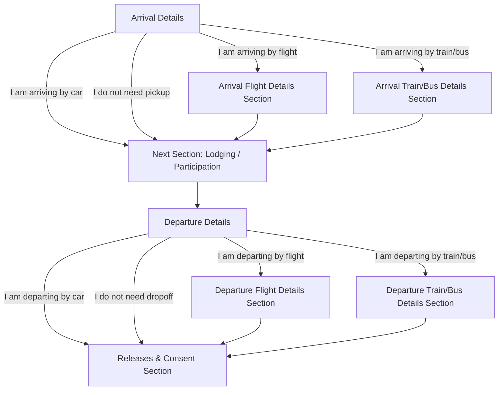

# Event Registration Fields Schema & Technical Specification

## Overview
This document specifies the technical schema, data types, validation constraints, conditional branching behaviors, and downstream spreadsheet column mappings for the USGA Event Registration Form Generator.

---

## 1. Supported Input Types & FormApp Method Mapping

The generator maps high-level schema types defined in the `Field Dictionary` directly to Google Forms API (`FormApp`) item types:

| Schema Input Type | FormApp Method | Default Behavior & Attributes |
|---|---|---|
| `Short Answer Text` | `form.addTextItem()` | Single-line text input. |
| `Paragraph` | `form.addParagraphTextItem()` | Multi-line text input for open-ended questions, notes, and medical details. |
| `Radio` / `Multiple choice` | `form.addMultipleChoiceItem()` | Single-selection option list. Supports `.showOtherOption(true)`. |
| `Checkboxes` | `form.addCheckboxItem()` | Multi-selection checkboxes. Stores comma-separated values in Google Sheets. |
| `Dropdown` | `form.addListItem()` | Compact dropdown selection menu. |
| `Date` | `form.addDateItem()` | Standard calendar date picker (`YYYY-MM-DD`). |
| `Time` | `form.addTimeItem()` | Standard time picker (`HH:MM`). |
| `Date/Time` | `form.addDateTimeItem()` | Combined date and time picker. |

---

## 2. Validation Rules & Special Handlers

Several fields trigger custom validation rules, instructional guidance, or dynamic generation logic:

### Age Validation (`Age`)
* **Validation Constraint:** Strict whole integer between 1 and 99.
* **Code Implementation:**
  ```javascript
  const ageValidation = FormApp.createTextValidation()
    .setHelpText(t('Please enter a whole number between 1 and 99.'))
    .requireNumberBetween(1, 99)
    .requireWholeNumber()
    .build();
  item.setValidation(ageValidation);
  ```
* **Ordering:** Automatically injected into `Personal & Contact Info` directly before `Class to attend` or `Grade`.

### Parent/Guardian Information (`Name of Parent/Guardian...`)
* **Help Text:** Automatically accompanied by instructions: *"If participant is 18 or above, enter 'N/A'."*
* **Behavior:** Mandated for minor-inclusive events; automatically stripped from adult-only events.

### Minor's Email (`Minor's Email (at least 13 years of age)`)
* **Help Text:** Explains that providing the email authorizes designated church personnel to communicate directly regarding event schedules and logistics.
* **Email Safeguard:** Filtered out in `masterRespondToRegistration` so automated receipts and edit links are sent strictly to the primary parent/guardian email address.

### Lodging Before & After Date Calculation
* Automatically reads event `startDate` and `endDate` from the generator payload.
* Dynamically calculates and embeds the exact calendar date into the question title in both English and Chinese:
  * English: `(i.e. before 7/15/2026)`
  * Chinese: `(即 7/15/2026 之前)`

### Medical Consent & Liability Release
* **Section Header & Legal Preamble:** Displays the complete legal indemnification text in English and Traditional Chinese.
* **Choices:**
  * `Yes, I consent.` / `是，本人同意。`
  * `No, I do not grant medical consent...` / `否，本人不同意。`
* **Auto-Rejection Logic:** If a respondent selects "No", the background trigger flags `isRejected = true`, sends a specialized "Registration Not Accepted" notification, logs `Rejected Sent` in `Email Status`, and ignores the row in waitlist calculations.

### Airport Mapping & Preferred Stars
* Cross-references `Airport Mapping` tab against host church names.
* Injects preferred airports with star emojis (`⭐ SFO`) at the top of the choice list, followed by secondary airports and a custom "Other" option.

---

## 3. Travel Page Navigation Branching

To streamline the user experience, travel logistics questions use Form Page Breaks (`FormApp.ItemType.PAGE_BREAK`):



---

## 4. Downstream Spreadsheet Architecture

Each generated form links to a dedicated Google Sheet structured into modular tabs (plus the optional `Driver Roster` tab and a separate public driver workbook, see below):

### 1. `Form Responses 1`
Raw, immutable responses recorded directly by Google Forms.

### 2. `Participants`
* **Formula:** Dynamic `QUERY` formula outputting Unique First Name, Last Name, and Church, alphabetized by Last Name.
* **Header:** Summary counter displaying `="Total Participants: " & IF(A2="No responses yet", 0, COUNTA(A2:A))`.

### 3. `Pickup`
* **Columns (22) [V2.9.5; legacy sheets have 17 until synced]:**
  1. `First Name`
  2. `Last Name`
  3. `Email`
  4. `Phone Number`
  5. `Arrival Details`
  6. `Arrival Date`
  7. `Arrival Time`
  8. `Departing City/Airport`
  9. `Arrival City/Airport`
  10. `Arrival Airline`
  11. `Arrival Flight Number`
  12. `Arrival Train/Bus Station`
  13. `Arrival Carrier`
  14. `Arrival Train/Bus Number`
  15. `Status`
  16. `Driver Full Name` *(Manual entry or synced from public sheet)*
  17. `Driver Phone Number` *(Manual entry or synced from public sheet; plain text)*
  18. `Trip Sub-ID` *(System; plain text)*
  19. `Vehicle Slot` *(System)*
  20. `Driver Vehicle / Notes` *(Synced from public sheet)*
  21. `Coordinator Status` *(Dropdown: Unassigned, Driver Claimed, Confirmed / Contacted, Reassign Needed, Completed)*
  22. `One-Click Dispatch SMS Text` *(System-generated copy-ready message)*
* **Sorting:** Automatically sorted chronologically by **Date (Col 6), Time (Col 7), Flight/Airport (Col 9)**.
* **Matching:** Evaluated on composite key `(First Name + Last Name + Email)`.
* **Trip Sub-ID format:** `[TYPE]-[HUB]-[CARRIER]-[MMDD]-[HHMM]-[SLOT]`, e.g. `PU-SFO-UA1234-1025-1430-A` (`WIN` replaces the carrier for multi-flight window runs).

### 4. `Drop-Off`
* **Columns (22) [V2.9.5]:** Columns 1–17 as below, plus columns 18–22 identical to `Pickup` (`Trip Sub-ID`, `Vehicle Slot`, `Driver Vehicle / Notes`, `Coordinator Status`, `One-Click Dispatch SMS Text`) with `DO-` Sub-IDs.
  1. `First Name`
  2. `Last Name`
  3. `Email`
  4. `Phone Number`
  5. `Departure Details`
  6. `Departure Date`
  7. `Departure Time`
  8. `Departure City/Airport`
  9. `Departure Airline`
  10. `Departure Flight Number`
  11. `Destination City/Airport`
  12. `Departure Train/Bus Station`
  13. `Departure Carrier`
  14. `Departure Train/Bus Number`
  15. `Status`
  16. `Driver Full Name` *(Manual volunteer entry)*
  17. `Driver Phone Number` *(Manual volunteer entry)*
* **Sorting:** Automatically sorted chronologically by **Date (Col 6), Time (Col 7), Flight/Airport (Col 8)**.

### 5. `Logistics`
* **Columns:** `First Name`, `Last Name`, `Email`, `Phone`, dynamically followed by active lodging questions (`Gender`, `Age`, `Staying at Host Church?`, `Lodging Before`, `Lodging After`, `Food/Medicine Restrictions`, `Sleep Preferences & Habits`, `Other Special Needs`), ending with coordinator assignment columns:
  * `Room Assignment` *(Manual entry)*
  * `Group/Team` *(Manual entry)*
  * `Notes` *(Manual entry)*
* **Lodging Compatibility:** Maps both standardized questions (`I will be staying at the hosting church.`) and legacy/historical headers (`Lodging Arrangement 住宿安排`, `住宿安排`) into `Staying at Host Church?`.

### 6. `Summary Dashboard`
* Centralized KPI dashboard aggregating Total Registrants, Travel Logistics by mode, Church Lodging (with dual-compatibility matching modern `Yes*`/`No*` and legacy `*host church*`/`*self*` responses), Pre/Post-Event Lodging, Dietary & Medical counts, Demographics (using prefix matching `"Male*"`, `"Female*"`), and Sleep Preferences with dynamic row sums (`=SUM(B:C)`).

### 7. `Airport Summary`
* Dynamically aggregates inbound and outbound passenger volumes by airport code, sorted in descending order (`ORDER BY COUNT(...) DESC`).

### 8. `Driver Roster` *(optional, created by transportation sync [V2.9.5])*
* **Columns:** `Driver Full Name`, `Driver Phone`, `Assigned Runs Count`, `Total Passengers`, `Vehicles / Notes`, `Upcoming Schedule Summary`. Rebuilt on every sync.

### Public Driver Signup Workbook *(separate file, optional [V2.9.5])*
* Linked from `Settings` via `PublicTransportSheetId` / `PublicTransportSheetUrl`. Contains `Instructions`, `Pickup Signups`, and `Drop-Off Signups`. Contains no attendee phone numbers or emails; passenger names are masked (`First L.`).
* **Columns (A–L), one row per vehicle slot:** `Trip Sub-ID`, `Date & Time`, `Airport / Station`, `Flight / Carrier`, `Vehicle Slot`, `Passengers`, `Luggage & Needs`, **`Driver Full Name`**, **`Driver Phone Number`**, **`Vehicle Model / Seats`**, **`Driver Notes`** (H–K editable), `Status` (`🟢 OPEN` / `🟡 CLAIMED`). Rows 1–2 are banner and headers.
* **`Settings` keys (optional):** `MaxPassengersPerCar`, `ArrivalClusterWindowMinutes`, `DepartureClusterWindowMinutes`, `CoordinatorName`, `CoordinatorPhone`.
